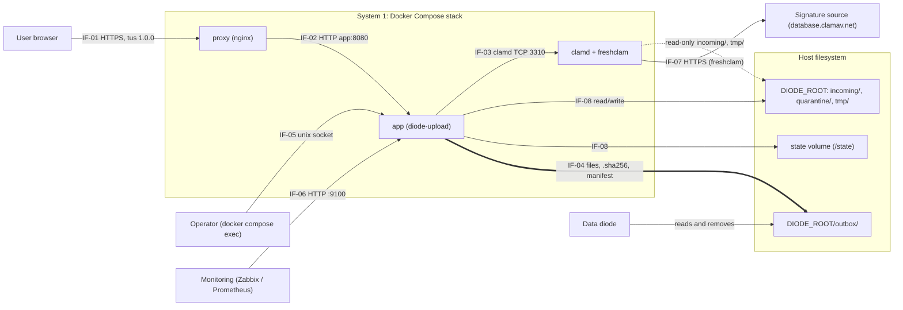

# Interface Control Document — Diode Upload Service (docker-secure-upload) — Rev 0.3

Nov 5, 2026 · @Nick

This ICD defines the eight interfaces between the Diode Upload Service and the parties around it, as built in release v0.5.3-beta (`VERSION` file; `main` at commit `eba3ef1`). Every value is taken from the code, compose file and shipped configuration at that commit; where the README differs, the code is stated and the difference is listed in section 4. It is a draft for review and nothing in it is agreed until the parties sign below.

## Document control

| Field | Value |
| --- | --- |
| Document title | Interface Control Document — Diode Upload Service (docker-secure-upload) |
| Document number | \[to be assigned\] |
| Revision | 0.3 (draft for review) |
| Stage | Beta, v0.5.3-beta. Stage 1 built; stage 2 (admin site) and stage 3 (metrics) designed, not built |
| System 1 | Diode Upload Service: repository nc-intezra/docker-secure-upload, Docker Compose project `diode-upload` |
| System 2 | One counterparty per interface; see section 1.3 |
| Baseline | `main` at `eba3ef1` (2026-11-05); `VERSION` = v0.5.3-beta |
| Classification | \[to be set by the owning organization\] |
| Template | Crossrail 7G-007 Detailed Design Interface Control Document Template, adapted for a software system |

## Document history

| Revision | Date | Prepared by | Checked by | Approved by | Reason for issue |
| --- | --- | --- | --- | --- | --- |
| 0.3 | 2026-11-05 | Nick Carter (drafted with Claude) |  |  | Rebased on v0.5.3-beta. Interfaces renumbered IF-01 to IF-08 (proxy, operator control socket and host storage now separate interfaces; audit log folded into IF-08; admin site and directory login moved to planned items). Oversize files now held by default; scan limit 2047 MiB (was 4000M); upload idle expiry 1 h (was 24 h); per-session and per-address caps with 429; nginx upload-creation rate limit; Unicode format characters and reserved suffixes in file names; manifest `audit_head`, versioned `generator`, `scan_status` `released` and release manifests; operator held-file CLI; unprivileged clamd with read-only `incoming/` and `tmp/` only; file modes 0640/0750 staging, 0644 outbox; complete audit event list; open issues re-baselined (section 4) |
| 0.2 | 2026-11-03 | Nick Carter |  |  | Outbox handoff: files keep the sender's name by default; batch prefix opt-in; same-name handling; open item 9 (written against the v0.5.2-beta content, `main` at 6b51468) |
| 0.1 | 2026-11-03 | Nick Carter |  |  | First draft for review (v0.5.1-beta) |

## Review and acceptance status

The reviewing authority marks one code when the document is submitted for acceptance.

| Code | Meaning | Selected |
| --- | --- | --- |
| 1 | Accepted; work may proceed |  |
| 2 | Not accepted; revise and resubmit; work may proceed subject to the indicated changes |  |
| 3 | Not accepted; revise and resubmit; work may not proceed |  |
| 4 | Received for information only |  |

| Reviewed / accepted by | Print name | Signature | Date |
| --- | --- | --- | --- |
|  |  |  |  |

Acceptance does not relieve the designer or supplier of their obligations, and it is not an approval of the design.

## ICD sign-off

**Reviewed by**

| Name | Role | Organization | Signed | Date |
| --- | --- | --- | --- | --- |
|  | Security reviewer |  |  |  |
|  | Infrastructure / host owner (IF-02, IF-08) |  |  |  |

**Agreed by**

| Name | Role | Organization | Signed | Date |
| --- | --- | --- | --- | --- |
| Nick Carter | Diode Upload Service owner (System 1) | Intezra |  |  |
|  | Data diode system owner (System 2, IF-04) |  |  |  |
|  | Monitoring owner (System 2, IF-06) |  |  |  |
|  | Operations / operator lead (System 2, IF-05) |  |  |  |

## 1 Introduction

### 1.1 Purpose of the document

This document records what the Diode Upload Service and each party it connects to agree: what crosses each boundary, in which direction and format, under which limits and timeouts, how errors are signalled, how the boundary is secured, and how it is verified. It is the reference for building, configuring and accepting both sides of every interface. A change to an agreed interface goes through change control and a new revision of this document.

### 1.2 Current status

Revision 0.3 describes stage 1 as built in v0.5.3-beta. Stage 1 covers the upload site, resumable uploads, SHA-256, ClamAV scanning, the outbox handoff, held-file operator commands and the audit log. Interfaces or parts of interfaces that are designed but not built are marked **Planned** wherever they appear.

There are no recorded disagreements between parties. Section 4 lists 23 open items: decisions needed from a counterparty, differences between the README and the code (the code is stated in this document), and known security items. The two security items that most affect deployment are:

- **No authentication (audit H-1).** Anyone who can reach port 443 can upload. Until login arrives with stage 2, the host firewall must restrict port 443 to approved client subnets.
- **Images not pinned by digest (audit M-6).** `compose.yaml` and the `Dockerfile` use tags (`nginxinc/nginx-unprivileged:stable-alpine`, `clamav/clamav:stable`, `golang:1.27-bookworm`, `gcr.io/distroless/static-debian12:nonroot`). Production must pin digests.

Revision 1.0 requires the conditions in section 3.2.

### 1.3 Interfaces covered by this document

System 1 is the whole Docker Compose stack: the `proxy` (nginx), `app` (Go service `diode-upload`) and `clamd` (ClamAV with freshclam) containers, their networks and volumes. IF-02 and IF-03 are internal to the stack; they are controlled here because the design allows the proxy or clamd to be replaced, and because their settings must match the app's.

| ID | Interface | Parties | Direction | Transport | Status |
| --- | --- | --- | --- | --- | --- |
| IF-01 | Upload site and API | User browser ↔ proxy/app | Bidirectional, browser initiates | HTTPS (TLS 1.2/1.3, HTTP/1.1 or HTTP/2), tus 1.0.0, JSON | Built |
| IF-02 | Reverse proxy | proxy → app | Proxy initiates | HTTP/1.1 on internal network `edge` (172.30.10.0/24) to `app:8080` | Built |
| IF-03 | Virus scanning | app → clamd | App initiates | clamd TCP protocol on internal network `scan`, port 3310 | Built |
| IF-04 | Outbox handoff | app → data diode | One way, file drop | Shared filesystem folder `DIODE_ROOT/outbox/` | Built |
| IF-05 | Operator control | Operator ↔ app | Operator initiates | `docker compose exec app diode-upload …`; HTTP over unix socket `/tmp/diode-upload.sock` | Built |
| IF-06 | Health and monitoring | Monitoring → app | Monitoring polls | HTTP on host port 9100 (`MONITORING_BIND`) | Health built; `/metrics` Planned |
| IF-07 | Signature updates | clamd (freshclam) → signature source | Outbound pull | HTTPS to `database.clamav.net` over network `updates` | Built; offline bundle Planned |
| IF-08 | Host storage and state | app ↔ host filesystem | Read/write | Bind mount `DIODE_ROOT` at `/data`; named volume `state` at `/state` | Built; retention Planned |

The diagram below shows each interface. The diode never connects to the service: it only reads and removes files in `outbox/`.



Arrows point from the initiating side. IF-04 (thick arrow) is the only path to the diode; IF-02, IF-03 and the control socket stay inside the stack, and clamd reads staging files from read-only mounts.

### 1.4 Definitions and abbreviations

| Term | Meaning |
| --- | --- |
| Batch | The files one user sends in one go; one batch ID, one manifest |
| Batch ID | `<UTC yyyymmddThhmmssZ>-<username>-<6 hex>`, e.g. `20261103T141502Z-jsmith-a3f9c1` |
| clamd | The ClamAV scanning daemon; freshclam is its signature updater |
| CSP | Content Security Policy response header |
| CSRF | Cross-site request forgery |
| DIODE\_ROOT | Host folder holding `outbox/`, `incoming/`, `quarantine/` and `tmp/`; mounted at `/data` in the app |
| EICAR | The standard harmless antivirus test file |
| Held | End state for a file that could not be scanned with a clear result; kept in `quarantine/` until an operator releases or deletes it |
| Manifest | JSON file describing a batch (`<batch_id>.manifest.json`) or a late release (`<batch_id>.release-<8 hex>.manifest.json`) |
| Outbox | `DIODE_ROOT/outbox/`, the folder the diode watches |
| Quarantine | `DIODE_ROOT/quarantine/`, holding infected and held files |
| Settle time | Time the diode waits after a file appears before collecting it; 2 s at this site (diode-side setting) |
| Sidecar | `<outbox name>.sha256`, written next to each file in the outbox |
| tus | Open protocol for resumable HTTP uploads, version 1.0.0 |
| Upload ID | 32 lowercase hex characters (128 random bits); the file's name in `incoming/` and `quarantine/` |
| Withheld | A file in the batch that did not go to the outbox (quarantined, deleted, held or expired/cancelled) |

### 1.5 Referenced documents

All repository paths are at commit `eba3ef1` of [nc-intezra/docker-secure-upload](https://github.com/nc-intezra/docker-secure-upload).

| Document | Version | Location |
| --- | --- | --- |
| README | eba3ef1 | `README.md` |
| Compose stack | eba3ef1 | `compose.yaml` |
| Site settings template | eba3ef1 | `.env.example` |
| Proxy configuration | eba3ef1 | `deploy/nginx/nginx.conf` |
| clamd and freshclam configuration | eba3ef1 | `deploy/clamd/clamd.conf`, `deploy/clamd/freshclam.conf` |
| Image build | eba3ef1 | `Dockerfile` |
| Service source | eba3ef1 | `cmd/diode-upload/`, `internal/` (tus, web, pipeline, store, audit, clamd, names, limits, control, config, fsutil) |
| Release notes | v0.5.0-beta to v0.5.3-beta | `.github/release-notes/` |
| CI workflow | eba3ef1 | `.github/workflows/ci.yml` |
| Previous ICD revision | Rev 0.2 | [Interface Control Document: Diode Upload Service](https://claude.ai/artifact/YRzGsN6HXcAe9RzmvLB2TL) |
| Design spec | 2026-10-30 | [Diode Upload Service: v1 design spec](https://claude.ai/artifact/NarfJQZ4dKew8XsEr38ChR) |
| tus resumable upload protocol | 1.0.0 | [tus.io](https://tus.io/protocols/resumable-upload) |
| ICD template | 7G-007 | [Crossrail Learning Legacy](https://learninglegacy.crossrail.co.uk/wp-content/uploads/2018/07/7G-007_Interface-Management-ICD-Template.pdf) |

## 2 Interface specifications and agreements

Each interface is fixed by the repository files listed in 2.1 at commit `eba3ef1`. Sections 2.2 to 2.9 summarize the values both sides must honor. Where this document and a referenced file disagree, the code at the stated commit is authoritative and this document must be corrected.

### 2.1 Interface register

| Item | Descriptor and type | System 1 sub-item (Diode Upload Service) | System 2 sub-item (counterparty) | Document references | Notes |
| --- | --- | --- | --- | --- | --- |
| IF-01 | Upload site and API. System: HTTPS, tus 1.0.0, JSON | nginx on host 443 → container 8443; app routes `/`, `/static/{file}`, `/api/v1/batches`, `/api/v1/uploads/` | User's browser: JavaScript, cookies, `fetch`, `XMLHttpRequest`; trusts the site CA | `internal/web/web.go`, `internal/tus/tus.go`, `internal/web/static/app.js`, `deploy/nginx/nginx.conf` | No user authentication (H-1) |
| IF-02 | Reverse proxy. System: HTTP/1.1 upstream | app listener `LISTEN_ADDR` `:8080`; trusts `X-Real-IP` from `TRUSTED_PROXY_CIDRS` | nginx (`nginxinc/nginx-unprivileged:stable-alpine`) | `deploy/nginx/nginx.conf`, `compose.yaml`, `internal/web/web.go` | Upstream keepalive 16 |
| IF-03 | Virus scanning. System: clamd TCP | `internal/clamd` client: `zPING`, `zVERSION`, `zSCAN <path>` | clamd (`clamav/clamav:stable`), `TCPSocket 3310` | `deploy/clamd/clamd.conf`, `internal/clamd/clamd.go`, `internal/pipeline/classify.go` | clamd sees `incoming/` and `tmp/` read-only only |
| IF-04 | Outbox handoff. System and information: filesystem drop | Writes data files, `.sha256` sidecars, batch and release manifests to `outbox/` | Diode watcher: collects after 2 s settle, removes what it collects | `internal/pipeline/pipeline.go`, `internal/names/names.go`, `internal/fsutil/fsutil.go`, README "Outbox format" | Same filesystem as staging; no acknowledgement path |
| IF-05 | Operator control. System: CLI over unix socket | `diode-upload held / release / delete / healthcheck / verify-audit / version` | Host administrator with Docker access | `cmd/diode-upload/*.go`, `internal/control/control.go`, `internal/pipeline/release.go` | Stands in for the stage 2 admin site |
| IF-06 | Health and monitoring. System: HTTP | `HEALTH_ADDR` `0.0.0.0:9100`: `/healthz`, `/readyz` | Zabbix HTTP agent or Prometheus | `cmd/diode-upload/main.go`, `Dockerfile` HEALTHCHECK | `/metrics` Planned (stage 3) |
| IF-07 | Signature updates. System: HTTPS pull | freshclam in the clamd container, network `updates` | ClamAV mirror `database.clamav.net` (or a site mirror) | `deploy/clamd/freshclam.conf`, `compose.yaml` | Offline (sneakernet) bundle Planned |
| IF-08 | Host storage and state. Physical and information | Layout under `/data` and `/state`; audit log | Host filesystem, Docker volumes `state` and `clamdb` | `internal/pipeline/pipeline.go` (Paths), `internal/store/store.go`, `internal/audit/audit.go`, README "Host layout" | Retention pruning Planned |

### 2.2 IF-01 Upload site and API (user browser ↔ proxy/app)

Users load one HTTPS page, start a batch, and send each file with tus 1.0.0 in chunks; every state-changing request must carry the page's session cookie, CSRF token and exact origin.

**Identification and transport**

| Parameter | Value |
| --- | --- |
| Parties | User's web browser (client) ↔ nginx `proxy` → `app` (server) |
| Direction | Browser initiates; data flows browser → service, status flows back |
| Address | `PUBLIC_ORIGIN` exactly (scheme, host, port); host port 443 on `HTTPS_BIND` (default `0.0.0.0`), nginx listens on 8443 |
| TLS | TLSv1.2 and TLSv1.3; certificate `deploy/tls/upload.crt`, key `upload.key`; session tickets off |
| HTTP | HTTP/1.1 and HTTP/2 (`http2 on`) |
| No plain HTTP | No port 80 listener; no redirect |
| Client needs | JavaScript, cookies, `fetch`, `XMLHttpRequest`, `TextEncoder`; no plug-ins |

**Endpoints**

| Method and path | Purpose | Request | Success |
| --- | --- | --- | --- |
| `GET /` | Upload page | none | 200 `text/html`; sets `__Host-sid` if absent; `Cache-Control: no-store`; meta tags `csrf-token`, `chunk-size`, `max-file-size`, `max-batch-files` |
| `GET /static/{file}` | Script and style; `{file}` must match \`^\[a-z0-9-\]+.(js | css)$\` | none |
| `POST /api/v1/batches` | Start a batch | JSON, below | 201 JSON |
| `GET /api/v1/batches/{id}` | Status of every file in the batch | none | 200 JSON |
| `OPTIONS /api/v1/uploads/` | tus discovery | none | 204, `Tus-Version: 1.0.0`, `Tus-Extension: creation,termination`, `Tus-Max-Size: <MAX_FILE_SIZE bytes>` |
| `POST /api/v1/uploads/` | tus create | `Upload-Length`, `Upload-Metadata`; empty body | 201, `Location: /api/v1/uploads/<32 hex>`, `Upload-Offset: 0` |
| `HEAD /api/v1/uploads/{id}` | Current offset | none | 200, `Upload-Offset`, `Upload-Length` (offset = length once complete) |
| `PATCH /api/v1/uploads/{id}` | Send one chunk | `Content-Type: application/offset+octet-stream`, `Upload-Offset`; body = chunk | 204, new `Upload-Offset` |
| `DELETE /api/v1/uploads/{id}` | tus termination of an unfinished upload | none | 204 |

Every tus request must carry `Tus-Resumable: 1.0.0`, and every tus response carries it with `Cache-Control: no-store`. Not supported: `Upload-Defer-Length` (400), creation-with-upload (a POST with a body is 400), checksum, concatenation and expiration extensions.

**tus `Upload-Metadata`** — comma-separated `key base64value` pairs; header at most 4096 bytes; each decoded value at most 1024 bytes; unknown or duplicate keys are rejected (400).

| Key | Required | Value |
| --- | --- | --- |
| `batch_id` | Yes | Batch ID from `POST /api/v1/batches`, matching `^[0-9]{8}T[0-9]{6}Z-[a-z][a-z0-9._-]{0,31}-[0-9a-f]{6}$`; must belong to the same session |
| `filename` | Yes | Original file name: valid UTF-8, 1 to 1024 bytes, no C0/C1 control characters, DEL, U+2028 or U+2029. Stored as `original_name`; never used as a path |

**`POST /api/v1/batches`** — `Content-Type: application/json`; body at most 16 KiB; unknown fields rejected.

| Field | Type | Rule |
| --- | --- | --- |
| `username` | string | Trimmed and lowercased, then `^[a-z][a-z0-9._-]{0,31}$` |
| `file_count` | integer | 1 to `MAX_BATCH_FILES` (default 500); the number of uploads the batch will accept |
| `prefix_names` | boolean, optional | Default `false`. `true` gives outbox names `<batch_id>_<seq>_<name>` (IF-04) |

Response 201: `{"batch_id": string, "username": string, "prefix_names": boolean}`.

**`GET /api/v1/batches/{id}`** response 200:

| Field | Type | Meaning |
| --- | --- | --- |
| `batch_id`, `username` | string | As created |
| `file_count` | integer | Declared count |
| `closed` | boolean | Manifest written |
| `prefix_names` | boolean | As created |
| `files[]` | array | One per created upload, in `seq` order |
| `files[].id` | string | Upload ID |
| `files[].seq` | integer | 1-based sequence in the batch |
| `files[].name` | string | Original name |
| `files[].size`, `files[].received` | integer | Declared size; bytes received |
| `files[].state` | string | Public state, below |
| `files[].sha256` | string, omitted if empty | Lowercase hex, once complete |
| `files[].sent_as` | string, omitted if equal to `name` | Outbox name (page shows "Arrives as") |

| Public `state` | Internal states (`store.State`) |
| --- | --- |
| `uploading` | `receiving` |
| `scanning` | `scanning` |
| `sent` | `passed`, `released` |
| `sent_unscanned` | `unscanned` |
| `blocked` | `quarantined`, `deleted` |
| `held` | `held` |
| `cancelled` | `expired` |

Signature names and internal reasons are never returned to users.

**Request integrity** — applied by the app to every method except GET, HEAD and OPTIONS, in this order. JSON failures are `403 {"error": <code>, "message": <text>}` and are logged as `request rejected` with `reason`, `method`, `path`, `client_ip`, `origin`, `expected_origin`, `sec_fetch_site`, `has_csrf_token` (header values clipped to 200 bytes).

| Check | Rule | Error code |
| --- | --- | --- |
| Session | Cookie `__Host-sid` = 64 lowercase hex (32 random bytes). Issued only on `GET /`; attributes `Path=/; Secure; HttpOnly; SameSite=Strict`; no expiry (browser session) | `no_session` |
| Origin | `Origin` header equals `PUBLIC_ORIGIN` byte for byte | `bad_origin` |
| Fetch metadata | `Sec-Fetch-Site`, if sent, equals `same-origin` | `bad_origin` |
| CSRF token | `X-CSRF-Token` equals hex HMAC-SHA256(CSRF key, `"csrf:" + session ID`), compared in constant time | `bad_csrf` |

No CORS headers are sent. Batches and uploads are bound to the SHA-256 of the session ID; another session's batch or upload answers 404, the same as a missing one.

**Response headers on every app response**

| Header | Value |
| --- | --- |
| `Content-Security-Policy` | `default-src 'none'; script-src 'self'; style-src 'self'; img-src 'self'; connect-src 'self'; form-action 'self'; base-uri 'none'; frame-ancestors 'none'; require-trusted-types-for 'script'; trusted-types 'none'` |
| `Strict-Transport-Security` | `max-age=63072000; includeSubDomains` |
| `X-Content-Type-Options` | `nosniff` |
| `X-Frame-Options` | `DENY` |
| `Referrer-Policy` | `no-referrer` |
| `Cross-Origin-Opener-Policy`, `Cross-Origin-Resource-Policy` | `same-origin` |
| `Permissions-Policy` | `camera=(), microphone=(), geolocation=(), payment=(), usb=()` |
| `Cache-Control` | `no-store` on `/api/*` and `/` |

**Limits and timing**

| Item | Value | Enforced by |
| --- | --- | --- |
| File size | `MAX_FILE_SIZE`, default 50 GiB; 413 at creation | app |
| Oversize policy `reject` | Files over `CLAMD_MAX_SCAN_SIZE` (2047 MiB) refused at creation, 413 | app |
| Chunk size | `CHUNK_SIZE`, default 64 MiB (allowed 1 MiB to 1 GiB); a PATCH body over min(chunk, remaining) is 413 | app; nginx caps body at 65 MiB |
| JSON bodies | 16 KiB | app and nginx (`client_max_body_size 16k`) |
| Files per batch | `file_count` ≤ `MAX_BATCH_FILES` (500); the (file\_count+1)th create is 409 | app |
| Per session | 10 open batches, 20 receiving uploads, 100 GiB not yet received | app, 429 + `Retry-After: 60` |
| Per client address | 30 open batches, 60 receiving uploads, 300 GiB not yet received | app, 429 + `Retry-After: 60` |
| Staging space | Free bytes in `incoming/` ≥ all unreceived bytes + new size + `DISK_RESERVE` (10 GiB), else 507 | app |
| Idle upload | No activity for `UPLOAD_EXPIRY` (1 h) → state `expired`, public `cancelled` | app (janitor, every 10 s) |
| Request rate | 20 req/s per IP, burst 100 (all paths except uploads); upload creation (POST) 2 req/s per IP, burst 20 | nginx, 429 |
| Connections | 20 concurrent per IP | nginx, 503 (`limit_conn_status` not set) |
| Timeouts | Client headers 10 s; gap between body reads 60 s; send 60 s; keepalive 30 s; upstream read/send 300 s on uploads | nginx |

**Error responses** — API errors are JSON `{"error","message"}`; tus errors are `text/plain` one-line messages.

| Status | Cause |
| --- | --- |
| 400 | Bad JSON, content type, `username` (`bad_username`), `file_count` (`bad_file_count`); bad `Upload-Length`, `Upload-Offset`, metadata, `batch_id` or file name; `Upload-Defer-Length`; body on create; PATCH with no data |
| 403 | Integrity check failed (table above); tus request with no session (`no session`) |
| 404 | Unknown, malformed or other-session batch or upload |
| 405 | Wrong method on a tus path, with `Allow: POST, OPTIONS` or `Allow: HEAD, PATCH, DELETE, OPTIONS` |
| 409 | Batch already has `file_count` uploads, or is closed; `Upload-Offset` does not match (current offset returned in `Upload-Offset`); upload already complete (PATCH or DELETE) |
| 412 | `Tus-Resumable` missing or not `1.0.0` (`Tus-Version: 1.0.0` returned) |
| 413 | File over `MAX_FILE_SIZE`; over the scan limit with policy `reject`; chunk too large (app or nginx) |
| 415 | PATCH `Content-Type` not `application/offset+octet-stream` |
| 423 | Another PATCH is writing the same upload |
| 429 | Per-session or per-address cap (app, `Retry-After: 60`); nginx rate limit |
| 500 | Internal error |
| 503 | nginx connection limit |
| 507 | Not enough staging space |

**Client behaviour (`app.js`, informative)** — two files upload in parallel; a 429 on create is retried after `Retry-After` (clamped 5 to 120 s) up to 30 times, showing "Waiting for your earlier uploads to finish"; 409, 423, 5xx and network errors on PATCH are retried with backoff (2 s doubling to 30 s, 30 attempts) after a HEAD to resync the offset; any other status is fatal and the upload is terminated with DELETE; batch status is polled every 2 s.

**Verification** — test (`TestRequestChecks`, `TestRejectionIsLogged`, `TestEndToEnd`, `TestLimits`, `TestCaps`, `TestCleanOriginal`); CI stack job (`scripts/smoke-test.sh` through the proxy, proxy rate limit) and headless Chromium upload of 2100 MiB through the page (`scripts/ci/browser-upload.mjs`).

### 2.3 IF-02 Reverse proxy (proxy → app)

nginx terminates TLS, applies coarse per-IP limits and streams requests to the app over the internal `edge` network; the app trusts the client address in `X-Real-IP` only from that network.

| Parameter | Value |
| --- | --- |
| Parties | `proxy` (nginx-unprivileged, uid 101) → `app` (uid 65532) |
| Transport | HTTP/1.1 to `upstream app { server app:8080; keepalive 16; }`; `Connection: ""` |
| Networks | `frontend` (proxy only, carries the published port) and `edge` (proxy and app; `internal: true`; subnet 172.30.10.0/24) |
| App listener | `LISTEN_ADDR` default `:8080`; `ReadHeaderTimeout` 10 s, `IdleTimeout` 2 min, `MaxHeaderBytes` 16 KiB, no read or write timeout (slow 64 MiB chunks) |
| Headers set by proxy | `Host: $host`; `X-Real-IP: $remote_addr`; `X-Forwarded-For` cleared |
| Client address | App uses `X-Real-IP` only when the TCP peer is inside `TRUSTED_PROXY_CIDRS` (compose: `172.30.10.0/24`); otherwise the peer address. IPv4-mapped IPv6 is unmapped |
| `location /api/v1/uploads/` | `client_max_body_size 65m`; `proxy_request_buffering off`; `proxy_buffering off`; `proxy_read_timeout 300s`; `proxy_send_timeout 300s`; `limit_req zone=create burst=20 nodelay` |
| `location /` | `client_max_body_size 16k` (server default); `limit_req zone=perip burst=100 nodelay`; nginx default upstream timeouts (60 s) |
| Rate-limit zones | `perip`: `$binary_remote_addr`, 10 MB, 20 r/s. `create`: key = client address for POST only (empty for other methods, so PATCH/HEAD/DELETE are not counted), 10 MB, 2 r/s. `conns`: 10 MB, `limit_conn conns 20` for the whole server |
| Limit status | `limit_req_status 429`; connection limit returns nginx default 503 |
| Client timeouts | `client_header_timeout 10s`; `client_body_timeout 60s` (gap between reads); `send_timeout 60s`; `keepalive_timeout 30s` |
| Temp paths | All under `/tmp` (tmpfs); uploads are never spooled to disk |
| Logging | JSON access log to stdout: `time`, `ip`, `method`, `uri`, `status`, `bytes_in`, `bytes_out`, `duration`; errors to stderr at `warn`; `server_tokens off` |
| Container | Read-only root, `cap_drop: ALL`, `no-new-privileges`, 256 MB, 1 CPU, 256 pids, logs 5 × 50 MB |

**Rule for any replacement proxy** — it must stream (not buffer) upload bodies, allow bodies of `CHUNK_SIZE` + 1 MiB on `/api/v1/uploads/`, set `X-Real-IP` and strip any client-supplied value, sit inside `TRUSTED_PROXY_CIDRS`, and pass `Origin`, `Sec-Fetch-Site`, `X-CSRF-Token`, `Cookie` and all `Tus-*` / `Upload-*` headers unchanged.

**Error handling** — nginx returns 413 (body too large), 429 (rate), 503 (connections) or 502/504 (app down or slow) itself; all other statuses come from the app (IF-01).

**Verification** — inspection of `deploy/nginx/nginx.conf`; CI stack job "upload creation is rate limited at the proxy" and the smoke test through the proxy; `TestLoad` parses `TRUSTED_PROXY_CIDRS`. No automated test covers trusted versus untrusted `X-Real-IP` handling (open item 19).

### 2.4 IF-03 Virus scanning (app → clamd)

The app asks clamd to scan each completed file by path; clamd reads the file from its own read-only mount, so no file data crosses the socket.

**Transport and protocol**

| Parameter | Value |
| --- | --- |
| Parties | `app` (client, `internal/clamd`) → `clamd` (server) |
| Transport | TCP to `CLAMD_ADDR`, default `clamd:3310`, on network `scan` (`internal: true`); no published port. clamd also has `LocalSocket /tmp/clamd.sock` inside its own container (not used by the app) |
| Framing | One command per connection: `z<COMMAND>\0`; reply read up to the first NUL, at most 64 KiB; trailing NUL and newline trimmed |
| Commands | `zPING` (expects `PONG`); `zVERSION` (`<engine>/<db version>/<db date>`, e.g. `ClamAV 1.4.1/27800/Thu Oct 29 08:24:02 2026`); `zSCAN <path>` |
| Dial timeout | 5 s |
| Scan timeout | `SCAN_TIMEOUT`, default 2 h per file (connection deadline) |
| Concurrency | `SCAN_CONCURRENCY`, default 2 (allowed 1 to 64); clamd `MaxThreads 4`, `MaxQueue 100` |
| Path | Server-generated only: `CLAMD_PATH_PREFIX` + path relative to `DATA_DIR`, e.g. `/data/incoming/<32 hex>`; a path with NUL, CR or LF is refused by the client |
| Mounts (clamd) | `${DIODE_ROOT}/incoming` → `/data/incoming:ro`; `${DIODE_ROOT}/tmp` → `/data/tmp:ro`. clamd cannot see `outbox/`, `quarantine/` or `/state` |
| File access | Staging files are mode 0640, group 65532; clamd runs as user `clamav` with `group_add: 65532` |

**Reply parsing (`ParseScanReply`)**

| Reply | Parsed as |
| --- | --- |
| `<path>: OK` | Verdict `OK` |
| `<path>: <signature> FOUND` | Verdict `FOUND`, signature; empty signature is an error |
| `<path>: <message> ERROR` | Verdict `ERROR`, message |
| `<message> ERROR` without the path prefix | Verdict `ERROR` |
| Anything else | Client error (never a pass) |

**Readiness gate (EICAR self-test)** — at start and then every hour the app runs `zPING`, `zVERSION`, writes the EICAR string to `tmp/tmp-<24 hex>` and requires a `FOUND` reply (2 min timeout). Until it passes, workers do not scan and `/readyz` is 503. After a failure it retries at 5 s, doubling to at most 1 min. The engine and database version from `zVERSION` are recorded as `<engine>/<db version>` (e.g. `ClamAV 1.4.1/27800`) in each scan record and manifest (`clamav_db`).

**Scanner unreachable** — a dial failure leaves the file in `scanning` and retries it after 15 s; such files are never passed or held for this reason. A shutdown mid-scan leaves the file in `scanning` and it is requeued at start.

**Required clamd settings** (`deploy/clamd/clamd.conf`; an external clamd must match)

| Setting | Value | Reason |
| --- | --- | --- |
| `MaxFileSize` | `2047M` | libclamav cannot scan one file over 2 GiB − 1 byte; `CLAMD_MAX_SCAN_SIZE` must equal this |
| `StreamMaxLength` | `2047M` | Not used (scan by path); kept consistent |
| `MaxScanSize` | `4000M` | Total extracted archive content scanned per file |
| `AlertExceedsMax` | `yes` | Report `Heuristics.Limits.Exceeded.*` instead of `OK` when a limit is hit |
| `MaxRecursion` / `MaxFiles` / `MaxScanTime` | `17` / `10000` / `3600000` ms | Archive-bomb limits |
| `AlertEncrypted` | `yes` | Encrypted archives and documents are reported (`Heuristics.Encrypted.*`) |
| `ScanArchive`, `ScanPDF`, `ScanOLE2`, `ScanHTML`, `ScanPE`, `ScanELF` | `yes` |  |
| `TCPSocket` / `TCPAddr` | `3310` / not set (all addresses in the container) |  |
| `ReadTimeout` / `CommandReadTimeout` / `SelfCheck` | `300` / `30` / `600` s |  |
| `ConcurrentDatabaseReload` | `yes` | Scanning continues during signature reloads |
| `Foreground` / `LogFile` | `yes` / not set (logs to container output) | `LogFile /dev/stdout` fails in a container |

**Classification (`internal/pipeline/classify.go`)** — `MaxScanSize` in the app means `CLAMD_MAX_SCAN_SIZE` (default 2047 MiB = 2 146 435 072 bytes).

| Scan outcome | `OVERSIZE_POLICY=hold` (default) | `pass` | `reject` |
| --- | --- | --- | --- |
| `OK`, size ≤ `CLAMD_MAX_SCAN_SIZE` | `passed` → outbox | `passed` | `passed` |
| `OK`, size > `CLAMD_MAX_SCAN_SIZE` | `held` | `unscanned` → outbox, flagged | never arrives (413 at create); `held` if it does |
| `FOUND Heuristics.Limits.Exceeded.MaxFileSize*` or `.MaxScanSize*` | `held` | `unscanned` | `held` |
| `FOUND Heuristics.Limits.Exceeded.*` (any other, e.g. `MaxRecursion`, `MaxFiles`, `MaxScanTime`) | `held` | `held` | `held` |
| Any other `FOUND` (including `Heuristics.Encrypted.*`) | `quarantined`, or `deleted` if `QUARANTINE_ENABLED=false` | same | same |
| `ERROR`, timeout, unparseable reply, client error | `held` | `held` | `held` |
| Staged file missing or size differs from `Upload-Length` | `held` (checked before scanning) | `held` | `held` |

**Security** — clamd runs as `clamav` via `/init-unprivileged`, read-only root, `cap_drop: ALL`, `no-new-privileges`, 4 GB, 2 CPUs, 512 pids; `scan` is internal, so clamd is reachable only from the app.

**Verification** — test (`TestParseScanReply`, `TestParseVersion`, `TestClassify`); CI clamd job with real `clamav/clamav:stable` and the shipped `clamd.conf` (`TestRealClamd`: PING, VERSION, clean `OK`, EICAR `FOUND`, 3000 MiB and 4001 MiB files flagged); CI stack job "clamd sees only incoming/ and tmp/, read-only" and "a file over 2 GiB is held".

### 2.5 IF-04 Outbox handoff (app → data diode)

The service hands files to the diode only by placing them, complete and atomically, in the folder the diode watches; there is no network link, signal or acknowledgement between the two systems.

**Folder and placement**

| Parameter | Value |
| --- | --- |
| Parties | `app` (writer, uid 65532) → diode watcher (reader; collects and removes) |
| Folder | `OUTBOX_DIR`, default `$DATA_DIR/outbox` = `/data/outbox` in the app = `DIODE_ROOT/outbox/` on the host |
| Precondition | `outbox/` must already exist (the app does not create it). At start the app refuses to run if `incoming/`, `quarantine/`, `tmp/` and `outbox/` are not on one filesystem (device ID check) or if a staging folder is inside the outbox |
| Layout | Flat. The app writes no subfolders and no temporary files in `outbox/`; temporary files live in `DIODE_ROOT/tmp/` |
| Folder mode (host) | `2775`, owner 65532, group shared with the diode (README; set by the site) |
| File mode | `0644` for data files, sidecars and manifests (data files are `chmod`ed from 0640 just before the move) |
| Data file placement | Hard link `incoming/<id>` (or `quarantine/<id>` on release) → `outbox/<name>`, which fails if the name exists; then unlink the source. If the filesystem refuses hard links: check the name is free, then `rename`. `fsync` of the outbox folder and the source folder after each move |
| Sidecar placement | Written and `fsync`ed in `tmp/`, then linked into `outbox/` without replacing; if a sidecar of the same name exists with identical content it is treated as already written |
| Manifest placement | Written and `fsync`ed in `tmp/`, then `rename`d into `outbox/` (replaces a same-named file; names are unique per batch, see open item 6); folder `fsync`ed |
| What the diode never sees | Partial files; files in `incoming/`, `quarantine/` or `tmp/`; the name or content of any withheld file |
| Service reads of outbox | `stat` of a target name and its `.sha256`; read of an existing sidecar to compare. The service never deletes from `outbox/` |

**Files that appear**

| File | Name | Content |
| --- | --- | --- |
| Data file | Outbox name (rules below) | The uploaded bytes, unchanged |
| Sidecar | `<outbox name>.sha256` | One line: 64 lowercase hex, two spaces, outbox name, LF. Works with `sha256sum -c` |
| Batch manifest | `<batch_id>.manifest.json` | JSON, 2-space indent, trailing LF; schema below |
| Release manifest | `<batch_id>.release-<first 8 hex of upload ID>.manifest.json` | Same schema with a `release` block; written only when a held file is released after its batch manifest has gone |

**Outbox name** — `SafeName(original)` by default; `<batch_id>_<seq>_<SafeName(original)>` when the batch was created with `prefix_names: true` (`seq` is `%03d`, e.g. `20261103T141502Z-jsmith-a3f9c1_001_report.pdf`). The name is fixed when the upload is created and shown to the user as `sent_as` when it differs from the original. `SafeName` applies these steps in order:

1. Replace `\` with `/` and keep only the part after the last `/`.
2. Replace with `_` every invalid UTF-8 sequence, C0 control (U+0000–U+001F), DEL, C1 control (U+0080–U+009F), U+2028, U+2029, every Unicode format character (category Cf: e.g. U+202E right-to-left override, U+2066–U+2069 isolates, U+200B zero-width space, U+200D, U+FEFF byte-order mark, U+00AD soft hyphen) and each of `< > : " / \ | ? *`.
3. Trim spaces; remove leading dots; remove trailing dots and spaces.
4. If nothing but `_` remains (or nothing), use `file`.
5. If longer than 180 bytes: keep the extension if it is 2 to 16 bytes including the dot, cut the stem on a UTF-8 character boundary so the total is at most 180 bytes, trim trailing dots and spaces.
6. If the part before the first dot, lowercased, is `con`, `prn`, `aux`, `nul`, `com1`–`com9` or `lpt1`–`lpt9`, prefix `_`.
7. If the lowercased name ends in `.sha256` or `.manifest.json` (reserved suffixes), append `_`.

Spaces, letters in any script, brackets and other punctuation are kept, so receiving-side scripts must quote names. The longest possible outbox name with prefix and `.sha256` is 250 bytes (61-byte prefix + 182-byte safe name + 7), within the 255-byte limit of common filesystems.

**Same name already present** — a file is never written over another. If `outbox/<name>` (a different file) or `outbox/<name>.sha256` exists, the file waits in staging and placement is retried every 10 s by the janitor. If the name is still taken 1 h (`OutboxWait`) after the scan (or release), the file becomes `held` with reason `a file with the same name stayed in the outbox for over 1h0m0s`, audit event `upload.held` (actor `system`/`outbox`), and moves to `quarantine/`. With the diode's 2 s settle time the wait is normally under 15 s.

**Ordering guarantees**

| Guarantee | Basis |
| --- | --- |
| A data file is complete when its name appears | Link or rename on one filesystem, after `fsync` of the data |
| A sidecar appears after its data file, never before | Sidecar step runs only after the data file is placed |
| A batch manifest appears after every created upload in the batch has reached an end state, been placed, and (if sent) had its sidecar written | `maybeCloseBatch` |
| A batch with fewer uploads than `file_count` is closed once nothing has happened in it for `UPLOAD_EXPIRY` (1 h); `missing_count` records the shortfall | `maybeCloseBatch` |
| A batch with no uploads gets no manifest; its record is deleted (audit `batch.discarded`) | Audit finding M-4 |
| Within a batch, files appear in scan-completion order, not `seq` order; there is no ordering between batches | 2 scan workers; janitor retries |
| The diode may collect a data file, its sidecar and the manifest in different cycles | Receiving side must not rely on them arriving together |

**Settle-time assumption** — the diode collects a file 2 s after it appears. Because every placement is atomic, integrity does not depend on the settle time; it only sets how quickly a same-named file can follow.

**Manifest schema** (`schema: 1`)

| Field | Type | Meaning |
| --- | --- | --- |
| `schema` | integer | `1` |
| `batch_id` | string | Batch ID |
| `username` | string | Normalized username |
| `created_at` | RFC 3339 UTC (may carry fractional seconds) | Batch creation |
| `closed_at` | RFC 3339 UTC | Manifest time |
| `file_count_declared` | integer | `file_count` from the browser; `1` in a release manifest |
| `files[]` | array (may be empty) | One entry per file sent to the outbox, in `seq` order |
| `files[].name` | string | Outbox name |
| `files[].original_name` | string | Name as sent by the browser (not sanitized; see open item 4) |
| `files[].size` | integer | Bytes |
| `files[].sha256` | string | 64 lowercase hex |
| `files[].scan_status` | `clean`, `unscanned` or `released` | `unscanned` = sent under `OVERSIZE_POLICY=pass` without a full scan; `released` = held, then released by an operator |
| `files[].scan_reason` | string, omitted if empty | Why unscanned; for released: `held (<held reason>); released by <name>: <reason>` |
| `files[].clamav_db` | string, omitted if empty | `<engine>/<db version>` at scan time |
| `files[].scanned_at` | RFC 3339 UTC | Scan decision time |
| `withheld_count` | integer | Files in the batch not sent: quarantined, deleted, held, or expired/cancelled; their names never cross |
| `missing_count` | integer | `file_count_declared` minus uploads created, if positive |
| `release` | object, release manifest only | `upload_id`, `held_reason`, `released_by`, `reason`, `released_at` (RFC 3339 UTC) |
| `audit_head` | object | `seq` (integer) and `hash` (64 hex) of the newest audit event when the manifest was written (L-1) |
| `generator` | string | `docker-secure-upload <version>`, e.g. `docker-secure-upload v0.5.3-beta` |

Fields have been added within `schema: 1` (`audit_head` in v0.5.3-beta), so receivers must ignore unknown fields.

```json
{
  "schema": 1,
  "batch_id": "20261103T141502Z-jsmith-a3f9c1",
  "username": "jsmith",
  "created_at": "2026-11-03T14:15:02.118Z",
  "closed_at": "2026-11-03T14:16:40.502Z",
  "file_count_declared": 2,
  "files": [
    {
      "name": "Quarterly Report (final).pdf",
      "original_name": "Quarterly Report (final).pdf",
      "size": 482113,
      "sha256": "<64 hex>",
      "scan_status": "clean",
      "clamav_db": "ClamAV 1.4.1/27800",
      "scanned_at": "2026-11-03T14:16:38.977Z"
    }
  ],
  "withheld_count": 1,
  "missing_count": 0,
  "audit_head": { "seq": 4182, "hash": "<64 hex>" },
  "generator": "docker-secure-upload v0.5.3-beta"
}
```

**Responsibilities**

| System 1 (Diode Upload Service) | System 2 (data diode and receiving side) |
| --- | --- |
| Only files in `passed`, `unscanned` or `released` enter the outbox | Collect every file that appears, keeping its name |
| Never writes partial or temporary files to the outbox; never replaces a data file or sidecar | Remove each file after collection, so space is freed and a same-named file can follow |
| Withheld files never appear by name or content | Do not rely on a file, its sidecar and its manifest arriving in one cycle |
| Refuses new uploads (507) when staging space, on the same filesystem, falls below the reserve | Verify files with `sha256sum -c` and read the manifests |
| Records `unscanned` and `released` in the manifest | Decide how to treat `unscanned` and `released` files (open item 9) and same-named arrivals (open item 7) |
| Keeps the sender's name unless the sender opts in to the prefix | Quote file names; treat `original_name` as untrusted text |

**If the diode stops collecting** — files build up on the shared filesystem; new uploads get 507 once free space would drop below `DISK_RESERVE`; same-named files are held after 1 h. Nothing reports the backlog today (open item 22).

**Security** — the outbox is the only path across the diode, so only the app writes to it; clamd cannot see it; the diode account needs read on files and write on the folder only.

**Verification** — test (`TestEndToEnd`: outbox names, sidecar, manifest fields, withheld names absent; `TestPlainNamesWaitForSameName`; `TestCrashRecoveryPlacesFile`; `TestSafeName`; `TestOutboxName`; `TestEmptyBatchDiscarded`; `TestReleaseBeforeBatchCloses`); CI smoke test checks outbox, sidecar, manifest and file modes. Transfer through the real diode: not yet demonstrated (open item 8).

### 2.6 IF-05 Operator control (operator ↔ app)

Until the stage 2 admin site exists, an operator with Docker access on the host lists, releases and deletes held files, and checks health, audit chain and version, by running the service binary inside the app container.

**Commands** — run as `docker compose exec app diode-upload <command>`.

| Command | Function | Output | Exit code |
| --- | --- | --- | --- |
| `held` | List `held` and `quarantined` files, oldest first | Table: `ID STATE USER SIZE RECEIVED NAME REASON` (reason includes `[signature]` when known; `RECEIVED` as `2006-01-02 15:04Z`), or `No held or quarantined files.` | 0; 1 if the socket is unreachable |
| `release ID --by NAME --reason TEXT` | Re-hash the held file; if it matches the received SHA-256, move it to the outbox under its outbox name with its sidecar (IF-04) | `Released <id> to the outbox as <name> (state released).` | 0; 1 refused; 2 usage |
| `delete ID --by NAME --reason TEXT` | Delete a `held` or `quarantined` file from `quarantine/`; state becomes `deleted` | `Deleted <id> (<original name>).` | 0; 1 refused; 2 usage |
| `healthcheck` | GET `http://<HEALTH_ADDR>/readyz` (`0.0.0.0` or empty host replaced with `127.0.0.1`), 3 s timeout | none | 0 if 200, else 1 |
| `verify-audit` | Verify the hash chain in `$STATE_DIR/audit` | `audit chain OK: <n> events` or `audit chain FAILED after <n> events: <reason>` | 0 or 1 |
| `version` (`--version`, `-v`) | Print version | `diode-upload v0.5.3-beta (<go version> linux/<arch>)` | 0 |
| any other |  | `unknown command "<x>"` | 2 |

`ID` may come before or after the flags. `--by` and `--reason` are required, trimmed, at most 500 bytes, valid UTF-8, with no control characters.

**Release rules** — only a file in state `held` that has been placed in `quarantine/` can be released; `quarantined` (infected) files are refused (`infected files cannot be released`). If the re-hash differs, the release is refused, audit `upload.release_refused` records expected and actual hashes, and the file stays held. If the batch is still open the file is listed in the batch manifest with `scan_status: released`; if the batch manifest has gone, a release manifest follows (IF-04). A released file is subject to the same-name wait and 1 h hold.

**Control socket protocol** (between the CLI and the running service; internal but specified so that the stage 2 admin site can reuse it)

| Parameter | Value |
| --- | --- |
| Socket | `CONTROL_SOCKET`, default `/tmp/diode-upload.sock` (tmpfs in the app container); `off` disables it |
| Access | Mode 0600 (umask 0177 at bind); every connection's peer uid (`SO_PEERCRED`) must equal the service uid, others are closed and logged `control socket: connection from another user refused` |
| Protocol | HTTP/1.1 over the unix socket, host `control`; `ReadHeaderTimeout` 5 s; client timeout 2 h (release re-hashes large files) |
| `GET /held` | 200, JSON array of items |
| `POST /release`, `POST /delete` | Body JSON `{"id", "by", "reason"}`, at most 8 KiB. 200 with the item; 400 `{"error":"bad request"}`; 404 unknown ID; 409 any other refusal, `{"error": <message>}` |

Item fields: `id`, `state`, `reason`, `signature` (omitted if empty), `username`, `client_ip`, `batch_id`, `original_name`, `outbox_name`, `size`, `sha256`, `received_at` (RFC 3339 UTC).

**Audit** — `upload.released`, `upload.release_refused` and `upload.discarded`, actor type `admin`, actor = `--by` value.

**Security** — reaching the commands requires Docker access on the host, which is root-equivalent; the operator name is self-declared and not authenticated. Nothing is exposed on the network.

**Verification** — test (`TestHoldAndRelease`, `TestReleaseBeforeBatchCloses`, `TestBigRelease`, TestRoundTrip in internal/control); CI stack job "held file can be listed and released" and release of a 2100 MiB held file uploaded from headless Chromium; CI `version` and `verify-audit` steps.

### 2.7 IF-06 Health and monitoring (monitoring → app)

Monitoring polls two plain-HTTP endpoints on port 9100; `/metrics` is designed for stage 3 and not built.

| Parameter | Value |
| --- | --- |
| Parties | Monitoring system (Zabbix HTTP agent or Prometheus) → `app` |
| Address | App listens on `HEALTH_ADDR`, default `0.0.0.0:9100`; compose publishes `${MONITORING_BIND:-127.0.0.1}:9100:9100` on network `monitoring` |
| Protocol | HTTP/1.1, no TLS, no authentication; `ReadHeaderTimeout` 5 s |
| `GET /healthz` | 200, empty body, whenever the process serves HTTP |
| `GET /readyz` | 200 when the clamd EICAR self-test has passed (IF-03) and free space on the `incoming/` filesystem is at least `DISK_RESERVE`. Otherwise 503 with body `scanner not ready` or `staging disk below reserve` |
| Docker health check | `diode-upload healthcheck` (IF-05): interval 30 s, timeout 5 s, start period 10 min, 3 retries |
| `GET /metrics` | **Planned (stage 3), not built.** Designed as Prometheus text format (Zabbix: HTTP agent with Prometheus pattern preprocessing), optional bearer token. Any other path answers 404 today |

**Suggested checks** — alert when `/readyz` is not 200 for 5 min. `/readyz` does not cover outbox backlog, signature age, held-file count or audit-chain health (open item 22); until `/metrics` exists, check those on the host (`held`, `verify-audit`, age of the oldest file in `outbox/`).

**Security** — bind 9100 only to the monitoring interface; the endpoints reveal readiness only.

**Verification** — CI stack job "wait for ready" polls `/readyz` until 200; Docker health check in compose. No unit test covers the 503 cases of `/readyz`; they are verified by inspection of `cmd/diode-upload/main.go`.

### 2.8 IF-07 Signature updates (clamd → signature source)

freshclam, inside the clamd container, pulls ClamAV signature updates from the public mirror over the `updates` network; an offline bundle for sites without egress is planned.

| Parameter | Value |
| --- | --- |
| Parties | freshclam (in `clamd`, user `clamav`, started by `/init-unprivileged`) → ClamAV database mirror |
| Direction | Outbound pull only |
| Transport | HTTPS from network `updates` (a non-internal bridge, so clamd has egress); the only container with a route out for this purpose |
| Source | `DatabaseMirror database.clamav.net`; `ScriptedUpdates yes` (incremental `.cdiff` updates) |
| Schedule | `Checks` not set in `freshclam.conf`, so freshclam's built-in default applies |
| Database location | Volume `clamdb` at `/var/lib/clamav`, owner `clamav` (`DatabaseOwner clamav`) |
| Reload | `NotifyClamd /etc/clamav/clamd.conf`; clamd reloads with `ConcurrentDatabaseReload yes` and also checks every 600 s (`SelfCheck`) |
| Logging | No `UpdateLogFile`; freshclam runs with `--stdout`, log rotated with the container |
| First start | Signatures download before clamd is healthy; the app does not scan until the EICAR self-test passes (IF-03) and its health check allows a 10 min start period |
| Effect of failure | clamd keeps scanning with the last database; scanning is not paused. The version in use is recorded per file (`clamav_db`). No signature-age alert exists until `/metrics` (open item 22) |
| Internal mirror (supported by configuration) | Point `DatabaseMirror` (or `PrivateMirror`) in `deploy/clamd/freshclam.conf` at a mirror on the `scan` network and remove `updates` from the clamd service in `compose.yaml` (comment in compose) |
| Offline bundle (sneakernet) | **Planned, not built.** No procedure, file format or tooling is in the repository (open item 23) |

**Security** — egress from `updates` should be restricted at the host or network firewall to the mirror; the database volume is writable only by `clamav`.

**Verification** — CI stack job "freshclam and clamd started without errors"; on-site observation of a successful update in the clamd log (rev 0.2 recorded one on 2026-10-31 on v0.5.1-beta; to be repeated on v0.5.3-beta with the unprivileged entrypoint).

### 2.9 IF-08 Host storage and state (app ↔ host)

The app keeps uploads under `DIODE_ROOT` and its records and audit log in the `state` volume; all writes that must survive a crash are written to a temporary file, `fsync`ed and renamed.

**DIODE\_ROOT layout** (one filesystem; mounted at `/data` in the app)

| Path (host) | In app | In clamd | Owner and mode | Content |
| --- | --- | --- | --- | --- |
| `DIODE_ROOT/` | `/data` | not mounted | 65532:65532, 0750 (README) | Parent folder |
| `incoming/` | `/data/incoming` | `/data/incoming` (ro) | 65532:65532, 0750; files 0640 | `<upload ID>` while receiving and scanning |
| `quarantine/` | `/data/quarantine` | not mounted | 65532:65532, 0750; files 0640 | `<upload ID>` for `held` and `quarantined` |
| `tmp/` | `/data/tmp` | `/data/tmp` (ro) | 65532:65532, 0750 | `tmp-<24 hex>`: EICAR self-test, sidecar and manifest staging; emptied at start |
| `outbox/` | `/data/outbox` | not mounted | 65532:\<diode group>, 2775; files 0644 | IF-04 |

`incoming/`, `quarantine/` and `tmp/` are created by the app if missing and their modes (and file modes) tightened to 0750/0640 at every start; the start fails if they are not owned by uid 65532. `incoming/` and `tmp/` must exist before the first start because clamd bind-mounts them. Capacity must cover uploads in progress, quarantine (no pruning), any outbox backlog and `DISK_RESERVE` (10 GiB); single files may be up to `MAX_FILE_SIZE` (50 GiB).

**State volume** (`state`, mounted at `/state`; owned by 65532 from the image; folders 0750, files 0640)

| Path | Content |
| --- | --- |
| `batches/<batch ID>.json` | Batch record: `id`, `username`, `client_ip`, `session_hash`, `file_count`, `prefix_names`, `created`, `created_at`, `closed_at`, `manifest_name` |
| `uploads/<upload ID>.json` | Upload record: `id`, `batch_id`, `seq`, `username`, `client_ip`, `session_hash`, `original_name`, `outbox_name`, `size`, `offset`, `hash_state` (saved SHA-256 state for resume), `sha256`, `state`, `scan_result`, `signature`, `scan_reason`, `clamav_db`, `placed`, `sidecar_done`, `created_at`, `updated_at`, `completed_at`, `scanned_at`, `held_reason`, `released_by`, `release_reason`, `released_at`, `manifest_done` |
| `tmp/` | Scratch for atomic record writes; emptied at start |
| `audit/audit-YYYY-MM-DD.jsonl` | Audit log, one file per UTC day |

All records are loaded into memory at start. A crash between a decision and a file move is completed by the janitor from the record (`placed`, `sidecar_done`, `manifest_done` flags).

**Upload states** (`internal/store`)

| State | Meaning | Next states |
| --- | --- | --- |
| `receiving` | Chunks arriving | `scanning`, `expired` (idle 1 h or cancelled) |
| `scanning` | Complete, queued or being scanned | `passed`, `unscanned`, `quarantined`, `deleted`, `held` |
| `passed` | Clean, sent to outbox | end |
| `unscanned` | Sent to outbox without a full scan (`OVERSIZE_POLICY=pass`) | end |
| `quarantined` | Infected, in `quarantine/` | `deleted` (operator) |
| `deleted` | Infected with quarantine off, or deleted by an operator | end |
| `held` | Unclear scan, oversize under `hold`, or same name blocked for 1 h; in `quarantine/` | `released`, `deleted` (operator) |
| `released` | Held, then released to the outbox by an operator | end |
| `expired` | Abandoned (no data for `UPLOAD_EXPIRY`) or cancelled by the user; staged data removed | end |

**Audit log format** — one JSON object per line, appended with `O_APPEND` and `fsync`ed per event, mode 0640.

| Field | Type | Meaning |
| --- | --- | --- |
| `seq` | integer | 1, 2, 3 … across all files |
| `ts` | RFC 3339 UTC | Event time (selects the daily file) |
| `actor_type` | `user`, `admin` or `system` |  |
| `actor` | string | Username, operator `--by` name, or `service`, `scanner`, `janitor`, `outbox` |
| `action` | string | Event name, below |
| `upload_id`, `batch_id` | string, omitted if empty |  |
| `details` | object of strings, omitted if empty | Event-specific |
| `prev_hash` | 64 hex | `hash` of the previous event; 64 zeros for the first event ever |
| `hash` | 64 hex | SHA-256 of the event serialized by Go `encoding/json` with `hash` set to `""` (field order as in this table; `details` keys sorted) |

**Audit events**

| Action | Actor | Details keys |
| --- | --- | --- |
| `service.started` | system / service | `version`, `oversize_policy`, `quarantine_enabled` |
| `batch.created` | user | `client_ip`, `file_count`, `prefix_names` |
| `batch.closed` | system / outbox | `manifest`, `passed`, `withheld`, `missing` |
| `batch.discarded` | system / janitor | `reason`, `file_count_declared` |
| `upload.created` | user | `size`, `original_name` |
| `upload.received` | user | `sha256`, `size` (`sha256` only for zero-byte files) |
| `upload.cancelled` | user | none |
| `upload.expired` | system / janitor | `received`, `size` |
| `upload.passed`, `upload.unscanned`, `upload.quarantined`, `upload.deleted`, `upload.held` | system / scanner | `state`, `sha256`, `size`, `reason` (if any; includes the signature name) |
| `upload.held` | system / outbox | `reason` (same name blocked for 1 h) |
| `upload.released` | admin | `reason`, `held_reason`, `sha256`, `outbox_name` |
| `upload.release_refused` | admin | `reason`, `expected`, `actual` |
| `upload.discarded` | admin | `reason`, `previous_state` |

**Integrity check** — `diode-upload verify-audit` (IF-05) reads all daily files in name order and checks `seq` continuity, the `prev_hash` link and each recomputed `hash`. The first event's `prev_hash` is accepted as the starting point, so a pruned prefix verifies; detecting removal of the oldest files relies on `audit_head` values kept from manifests on the receiving side (open item 5).

**Sensitivity** — the audit log and records hold usernames, client IP addresses, original file names, hashes and signature names; restrict to host administrators.

**Retention** — **not implemented.** Audit files, records and `quarantine/` grow without limit; pruning (designed as 90 days with a chain checkpoint) is Planned for stage 2 (open item 21). Container logs: json-file, 5 × 50 MB per container.

**Host prerequisites** — Docker Engine and the Compose v2 plugin from Docker's apt repository (not the Ubuntu snap); at least 4 cores and 6 GB RAM (limits: proxy 256 MB/1 CPU/256 pids, app 512 MB/2 CPUs/256 pids, clamd 4 GB/2 CPUs/512 pids); `secrets/csrf_key` at least 32 bytes after trimming (`head -c 48 /dev/urandom | base64`), mode 600, mounted at `/run/secrets/csrf_key`; `deploy/tls/upload.crt` and `upload.key` readable by uid 101; `config/instructions.md` mounted read-only (built-in text if empty).

**Verification** — test (`TestChainAndTamperDetection`, `TestCrashRecoveryPlacesFile`, `TestLoad`); CI image job "new state volume is writable by the app user"; CI stack `verify-audit`; startup checks (same device, staging not inside outbox, ownership).

### 2.10 Configuration parameters

App settings are environment variables read by `internal/config` at start; an invalid value stops the service. Sizes accept `K`/`M`/`G`/`T` or `KiB`/`MiB`/`GiB`/`TiB` (all binary) or plain bytes; durations accept Go syntax plus `<n>d`. Where `compose.yaml` sets a value it overrides the code default, so both are shown.

| Variable | Code default | Value in `compose.yaml` | Site-set in `.env` | Interface | Rule / notes |
| --- | --- | --- | --- | --- | --- |
| `PUBLIC_ORIGIN` | none (required) | `${PUBLIC_ORIGIN:?}` | Yes, e.g. `https://upload.example.internal` | IF-01 | Scheme and host, optional port, no path |
| `LISTEN_ADDR` | `:8080` | not set | No | IF-02 | Not in README table (open item 20) |
| `TRUSTED_PROXY_CIDRS` | empty | `172.30.10.0/24` | No | IF-02 | Comma-separated CIDRs |
| `DATA_DIR` | `/data` | `/data` | No | IF-08 | Absolute path |
| `OUTBOX_DIR` | `$DATA_DIR/outbox` | `/data/outbox` | No | IF-04 | Absolute path; must exist |
| `STATE_DIR` | `/state` | `/state` | No | IF-08 | Absolute path |
| `INSTRUCTIONS_FILE` | `/config/instructions.md` | via mount | No | IF-01 | Headings, lists, paragraphs, `**bold**`; all text escaped |
| `CSRF_KEY_FILE` | `/run/secrets/csrf_key` | `/run/secrets/csrf_key` | No | IF-01 | ≥ 32 bytes after trimming |
| `MAX_FILE_SIZE` | `50GiB` | `${MAX_FILE_SIZE:-50GiB}` | Yes | IF-01 | > 0 |
| `CHUNK_SIZE` | `64MiB` | `64MiB` | No | IF-01, IF-02 | 1 MiB to 1 GiB; nginx upload body limit must be this + 1 MiB |
| `DISK_RESERVE` | `10GiB` | not set | No | IF-01, IF-06 | Free space kept beyond unreceived bytes |
| `UPLOAD_EXPIRY` | `1h` | `${UPLOAD_EXPIRY:-1h}` | Optional | IF-01, IF-04 | ≥ 1 min; idle upload expiry and idle batch close |
| `MAX_BATCH_FILES` | `500` | not set | No | IF-01 | ≥ 1 |
| `CLAMD_ADDR` | `clamd:3310` | `clamd:3310` | No | IF-03 | host:port |
| `CLAMD_PATH_PREFIX` | `$DATA_DIR` | not set | No | IF-03 | `DATA_DIR` as clamd sees it |
| `CLAMD_MAX_SCAN_SIZE` | `2047M` | `2047M` | No | IF-03 | Must equal clamd `MaxFileSize` |
| `SCAN_CONCURRENCY` | `2` | not set | No | IF-03 | 1 to 64 |
| `SCAN_TIMEOUT` | `2h` | not set | No | IF-03 | Per file |
| `OVERSIZE_POLICY` | `hold` | `${OVERSIZE_POLICY:-hold}` | Yes (`.env.example`: `hold`) | IF-03, IF-04 | `hold`, `pass` or `reject` |
| `QUARANTINE_ENABLED` | `true` | `${QUARANTINE_ENABLED:-true}` | Yes | IF-03 | `false` deletes infected files |
| `SESSION_MAX_OPEN_BATCHES` | `10` | `${…:-10}` | Optional | IF-01 | 0 = no cap |
| `SESSION_MAX_OPEN_UPLOADS` | `20` | `${…:-20}` | Optional | IF-01 | 0 = no cap |
| `SESSION_MAX_RESERVED` | 2 × `MAX_FILE_SIZE` | `${…:-100GiB}` | Optional | IF-01 | Compose fixes 100 GiB (open item 17) |
| `IP_MAX_OPEN_BATCHES` | 3 × session value | `${…:-30}` | Optional | IF-01 | 0 = no cap |
| `IP_MAX_OPEN_UPLOADS` | 3 × session value | `${…:-60}` | Optional | IF-01 | 0 = no cap |
| `IP_MAX_RESERVED` | 3 × session value | `${…:-300GiB}` | Optional | IF-01 | Compose fixes 300 GiB (open item 17) |
| `CONTROL_SOCKET` | `/tmp/diode-upload.sock` | not set | No | IF-05 | `off` disables operator commands |
| `HEALTH_ADDR` | `0.0.0.0:9100` (service); `127.0.0.1:9100` (healthcheck if unset) | `0.0.0.0:9100` | No | IF-06 |  |

**Compose-level variables** (read only by `compose.yaml`)

| Variable | Default | Interface | Notes |
| --- | --- | --- | --- |
| `DIODE_ROOT` | none (required) | IF-04, IF-08 | Host folder; `.env.example`: `/srv/diode-upload` |
| `HTTPS_BIND` | `0.0.0.0` | IF-01 | Host address for port 443 |
| `MONITORING_BIND` | `127.0.0.1` | IF-06 | Host address for port 9100 |

**Settings fixed in shipped files** — nginx values in IF-02; clamd values in IF-03; freshclam values in IF-07; compose resource limits in IF-08.

## 3 Verification and validation

Most built interface requirements below are verified by automated tests or CI jobs at `eba3ef1`; none is yet demonstrated on the production host or through the real diode, and those on-site demonstrations are the remaining condition for revision 1.0.

### 3.1 Interface requirements and verification matrix

Methods: **T** automated test (`go test`, CI), **I** inspection of configuration or code, **D** on-site demonstration. "CI" means the `ci` workflow (unit and end-to-end tests, real-clamd job, full-stack job with headless Chromium).

| Req | Interface | Requirement | Method | Evidence | Status |
| --- | --- | --- | --- | --- | --- |
| R-01 | IF-01 | Writes without a session, with a wrong or missing `Origin`, a cross-site `Sec-Fetch-Site` or a wrong `X-CSRF-Token` are refused with 403 and logged | T | `TestRequestChecks`, `TestRejectionIsLogged` | Passed (CI) |
| R-02 | IF-01 | Another session's batch or upload answers 404 | T | `TestRequestChecks` | Passed (CI) |
| R-03 | IF-01 | tus create, HEAD, PATCH, DELETE behave as in 2.2, including resume after an interrupted chunk and 409 on a stale offset, 413, 415 | T | `TestEndToEnd`, `TestRequestChecks` | Passed (CI) |
| R-04 | IF-01 | Per-session and per-address caps answer 429 with `Retry-After`; the page waits and retries | T | `TestLimits`, `TestCaps` | Passed (CI) |
| R-05 | IF-01 | A 2100 MiB file uploads through the real page in a browser | T | CI headless Chromium (`scripts/ci/browser-upload.mjs`) | Passed (CI) |
| R-06 | IF-01 | Security headers and CSP as in 2.2 on every response; no console or CSP errors | I, T | `internal/web/web.go`; CI browser run | Passed |
| R-07 | IF-02 | Upload bodies are streamed, capped at 65 MiB; upload creation limited to 2 r/s burst 20 with 429 | I, T | `nginx.conf`; CI "upload creation is rate limited at the proxy" | Passed |
| R-08 | IF-02 | `X-Real-IP` is trusted only from `TRUSTED_PROXY_CIDRS` | I | `web.go` `clientIP` | Inspected; no test (open item 19) |
| R-09 | IF-03 | No scan until clamd detects EICAR; repeated hourly | T | `CI stack "wait for ready" (/readyz requires the self-test); gating in pipeline.process by inspection` | Passed (CI) |
| R-10 | IF-03 | Real clamd with shipped `clamd.conf`: PING, VERSION, clean `OK`, EICAR `FOUND`, 3000 MiB and 4001 MiB flagged `Heuristics.Limits.Exceeded.*` | T | CI clamd job, `TestRealClamd` | Passed (CI) |
| R-11 | IF-03 | Classification as in 2.4 for every reply and policy; nothing unclear is passed | T | `TestClassify`, `TestQuarantineOffDeletes` | Passed (CI) |
| R-12 | IF-03 | clamd sees only `incoming/` and `tmp/`, read-only | T | CI stack "clamd sees only incoming/ and tmp/, read-only" | Passed (CI) |
| R-13 | IF-04 | Outbox names, sidecar line, manifest fields as in 2.5; withheld names absent | T | `TestEndToEnd`, `TestSafeName`, `TestOutboxName` | Passed (CI) |
| R-14 | IF-04 | No overwrite; same-name file waits, then is held after 1 h | T | `TestPlainNamesWaitForSameName` | Passed (CI) |
| R-15 | IF-04 | A decision recorded before a crash is completed by the janitor | T | `TestCrashRecoveryPlacesFile` | Passed (CI) |
| R-16 | IF-04 | Outbox files 0644; staging and quarantine 0640 | T | `TestHoldAndRelease`, smoke test | Passed (CI) |
| R-17 | IF-04 | Files over 2047 MiB are held under the default policy, and are released intact | T | CI stack "a file over 2 GiB is held" and browser 2100 MiB release; `TestBigRelease` | Passed (CI) |
| R-18 | IF-04 | Files cross the real diode; receiving side verifies `sha256sum -c` and reads manifests | D | — | Not done (open item 8) |
| R-19 | IF-05 | `held`, `release`, `delete` work as in 2.6; infected files cannot be released; tampered files are refused | T | `TestHoldAndRelease`, `TestReleaseBeforeBatchCloses`, `TestRoundTrip`, CI stack | Passed (CI) |
| R-20 | IF-05 | Control socket refuses other user IDs | I | `control.go` `sameUser` | Inspected |
| R-21 | IF-06 | `/readyz` 200 only when clamd is proven and disk is above reserve | I, T | `main.go`; CI "wait for ready" | Partly tested (200 path only) |
| R-22 | IF-06 | Monitoring alerts on `/readyz` | D | — | Not done |
| R-23 | IF-07 | freshclam updates signatures under the unprivileged entrypoint | T, D | CI stack "freshclam and clamd started without errors"; on-site log | CI passed; on-site not repeated on v0.5.3-beta |
| R-24 | IF-08 | Edited, deleted or reordered audit entries are detected | T | `TestChainAndTamperDetection`, CI `verify-audit` | Passed (CI) |
| R-25 | IF-08 | Service refuses to start with staging and outbox on different filesystems or staging inside the outbox | I | `pipeline.Paths.Prepare` | Inspected |
| R-26 | IF-08 | A new state volume is writable by uid 65532 | T | CI image job | Passed (CI) |

### 3.2 Interface review and sign-off

Both parties review this document at an interface review meeting and record actions. When the conditions below are met they sign the agreement in the sign-off section and the reviewing authority marks its acceptance code.

| Item | Value |
| --- | --- |
| Interface review meeting | \[date, attendees\] |
| Interface certificate | \[reference, date\] |

Conditions for revision 1.0:

- [ ] Open items 7 to 15 in section 4 decided by the named parties
- [ ] v0.5.3-beta (tagged) installed on the host, with the upgrade steps in its release notes done
- [ ] R-18: on-site transfer through the real diode verified on the receiving side
- [ ] R-22: monitoring checks `/readyz`
- [ ] R-23: signature update observed on the host on v0.5.3-beta
- [ ] Host firewall restricts port 443 to approved client subnets (open item 1)
- [ ] Images pinned by digest in the production compose file (open item 2)

## 4 Open issues, discrepancies and known security items

24 items are open: 6 security items, 9 decisions needed from a counterparty, 6 differences between the README, comments or behaviour and the code (the code is what this ICD states), and 3 planned capabilities that interfaces depend on. Rev 0.2 items are carried forward with new numbers; its item 1 (files over \~4 GB passed unscanned) is superseded by the `hold` default and becomes item 9.

| # | Type | Item | Interface | Current state | Decision or action from |
| --- | --- | --- | --- | --- | --- |
| 1 | Security | No authentication (audit H-1): anyone who can reach port 443 can upload under any username | IF-01 | Host firewall must restrict 443 to approved client subnets; login and allowlist planned with stage 2 | Infrastructure owner; service owner |
| 2 | Security | Images not pinned by digest (audit M-6): `nginxinc/nginx-unprivileged:stable-alpine`, `clamav/clamav:stable`, `golang:1.27-bookworm`, `gcr.io/distroless/static-debian12:nonroot` | IF-02, IF-03, IF-08 | Tags only; comments say pin in production | Service owner |
| 3 | Security | The app joins the non-internal `monitoring` network to publish 9100, which also gives it an outbound route it does not need | IF-06 | Not restricted in compose | Service owner; infrastructure owner (host egress rules) |
| 4 | Security | `original_name` is only checked for UTF-8, length and control characters, so it can carry Unicode format characters (e.g. U+202E) into the manifest, batch status and audit log; only the outbox name is sanitized | IF-01, IF-04 | Receiving side and any viewer must treat `original_name` as untrusted text | Data diode system owner; service owner |
| 5 | Security | `verify-audit` accepts the first event's `prev_hash` as the start, so deleting the oldest daily files is not detected locally; the hash input is defined only by Go `encoding/json`, with no written canonical form for third-party verifiers | IF-08 | Mitigated by `audit_head` in manifests if the receiving side keeps them | Service owner; data diode system owner |
| 6 | Security | Batch and release manifests are placed with `rename`, which would replace a same-named file, unlike data files and sidecars (no-replace) | IF-04 | Names are unique per batch ID and upload ID, so a clash is not expected | Service owner |
| 7 | Decision | Files keep senders' names, so a second file with the same name can reach the receiving side: overwrite, keep both, or reject? | IF-04 | Upload side never overwrites in the outbox; receiving-side behaviour unknown (rev 0.2 item 9) | Data diode system owner |
| 8 | Decision | End-to-end transfer through the real diode, including sidecar and manifest handling on the receiving side, not yet demonstrated | IF-04 | None (rev 0.2 item 2) | Data diode system owner |
| 9 | Decision | How the receiving side treats `scan_status` `unscanned` (only under `OVERSIZE_POLICY=pass`) and `released` files; whether it rescans them | IF-04 | Default is now `hold`: files over 2047 MiB wait for an operator (supersedes rev 0.2 item 1) | Data diode system owner; security |
| 10 | Decision | Encrypted archives and documents cannot be inspected | IF-03 | `AlertEncrypted yes`: treated as infected (quarantined) (rev 0.2 item 3) | Service owner; security |
| 11 | Decision | Should users see the signature name when a file is blocked? | IF-01 | No; generic `blocked` only (rev 0.2 item 4) | Service owner; security |
| 12 | Decision | The single `PUBLIC_ORIGIN` users must use, and the CA that issues its certificate | IF-01 | None set for production (rev 0.2 item 5) | Infrastructure owner |
| 13 | Decision | File types to refuse outright, if any | IF-01 | None refused (rev 0.2 item 6) | Service owner; security |
| 14 | Decision | Cap and rate values from real traffic, including shared addresses (terminal servers, NAT) that hit `IP_MAX_*` | IF-01, IF-02 | Defaults in 2.10 (rev 0.2 item 7) | Service owner |
| 15 | Decision | Reuse of the existing service's user instructions in `config/instructions.md` | IF-01 | Built-in text (rev 0.2 item 8) | Service owner |
| 16 | Discrepancy | nginx `limit_conn conns 20` answers 503 (no `limit_conn_status`), while request-rate limits answer 429; the page treats a 503 on upload creation as fatal | IF-01, IF-02 | Code: 503 | Service owner |
| 17 | Discrepancy | README says `SESSION_MAX_RESERVED` defaults to 2 × `MAX_FILE_SIZE` and `IP_MAX_*` to 3 × the session values. That is the code default, but `compose.yaml` sets fixed fallbacks (10/20/100GiB, 30/60/300GiB), so changing `MAX_FILE_SIZE` in `.env` does not move the caps | IF-01 | Code as deployed: fixed values from compose | Service owner |
| 18 | Discrepancy | The header comment of `deploy/clamd/clamd.conf` says `CLAMD_MAX_SCAN_SIZE` must match `MaxScanSize` (4000M); `config.go`, `compose.yaml`, the README and the later comment in the same file say `MaxFileSize` (2047M) | IF-03 | Code: `MaxFileSize` 2047M | Service owner (fix comment) |
| 19 | Discrepancy | README states the app trusts `X-Real-IP` only from the proxy; this is true in code but no automated test covers it | IF-02 | Inspected only | Service owner (add test) |
| 20 | Discrepancy | README drift: configuration table omits `LISTEN_ADDR` (`:8080`); Status table still says stage 1 "this commit" and lists rate limiting under stage 3 although caps shipped in v0.5.3-beta; held-file example reason differs from the code text (`file is <n> bytes, larger than the scanner limit of <n> bytes`); the manifest struct comment lists \`clean | unscanned`without`released\` | IF-01, IF-04, IF-05 | Code as stated in this ICD |
| 21 | Planned | Retention: no pruning of the audit log, records or `quarantine/` (designed: 90 days with a chain checkpoint) | IF-08 | Grows without limit; operators can delete held/quarantined files | Service owner (stage 2) |
| 22 | Planned | `/metrics` not built: no signal for outbox backlog, oldest outbox file, signature age, held count or scan queue | IF-06, IF-04, IF-07 | `/healthz`, `/readyz` only | Service owner (stage 3); monitoring owner |
| 23 | Planned | Offline (sneakernet) signature bundle for sites without egress is not described in the repository | IF-07 | Public mirror over `updates`, or a site mirror by editing `freshclam.conf` | Service owner; infrastructure owner |
