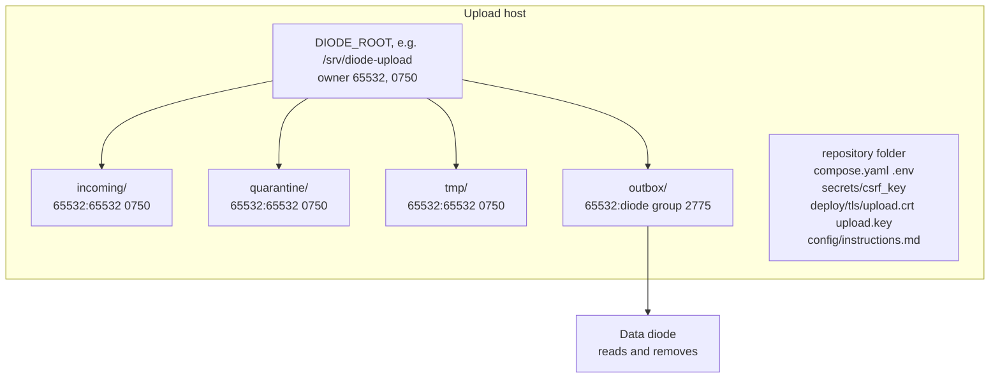
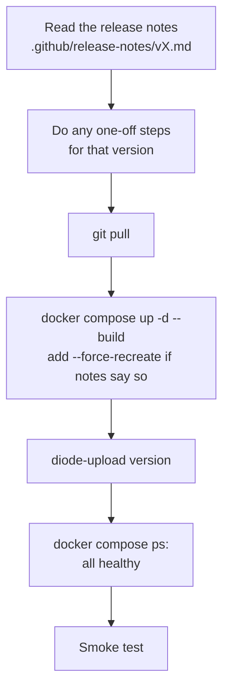
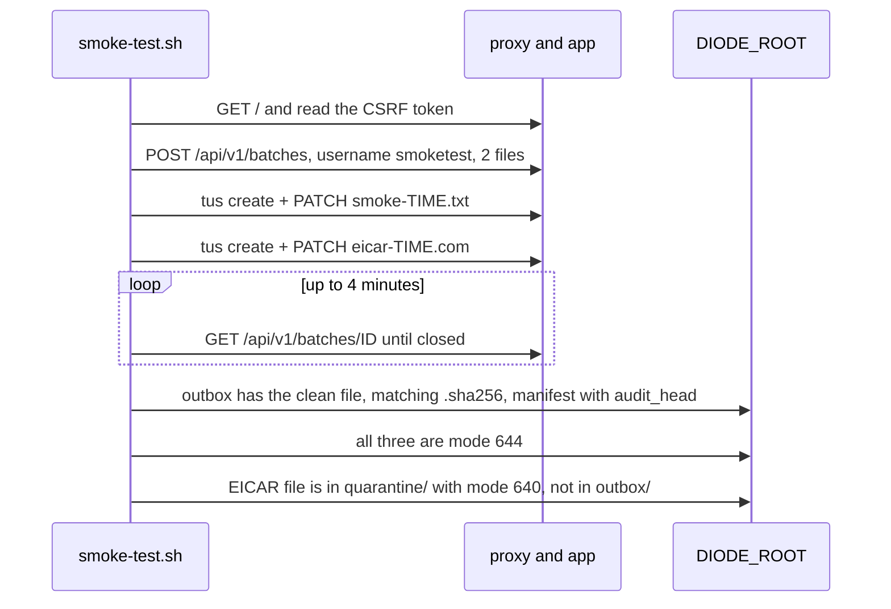

# Deployment and upgrade

How to set up the upload host, configure it, upgrade it and check it works.
The README in the repository has the same steps; this page adds the upgrade
path between versions.

## Requirements

- Linux host (written for Ubuntu Server), at least 4 CPU cores and 6 GB RAM.
  The compose memory limits add up to about 5 GB, mostly clamd (4 GB).
- Disk for in-flight uploads and quarantine, on the **same filesystem** as
  the diode's watched folder. Keep at least `DISK_RESERVE` (10 GiB) free
  beyond that.
- Docker Engine and the Compose plugin from Docker's own apt repository.
  `docker compose version` must report v2. **Do not use the Docker snap**:
  it cannot read `compose.yaml` outside your home folder or bind-mount
  `DIODE_ROOT`.
- A TLS certificate for the upload host name from your internal CA.

## Host layout



Create all four folders before the first start. clamd mounts `incoming/`
and `tmp/` directly; if they do not exist, Docker creates them owned by root
and the app cannot write to them.

```sh
sudo install -d -m 0750 -o 65532 -g 65532 /srv/diode-upload \
     /srv/diode-upload/incoming /srv/diode-upload/quarantine /srv/diode-upload/tmp
sudo install -d -m 2775 -o 65532 -g <diode-group> /srv/diode-upload/outbox
```

The diode's account needs read access to files in `outbox/` (they are 0644)
and write access to the folder, to remove what it has collected.

## First install

```sh
cp .env.example .env                                   # set PUBLIC_ORIGIN and DIODE_ROOT
head -c 48 /dev/urandom | base64 > secrets/csrf_key && chmod 600 secrets/csrf_key
# put upload.crt (with intermediates) and upload.key in deploy/tls/
#   scripts/dev-cert.sh <hostname> makes a self-signed pair for a test only
docker compose up -d --build
docker compose logs -f app                             # wait for "clamd self-test passed"
```

clamd downloads its signatures on first start, which can take several
minutes. Uploads are accepted meanwhile and scanned once it is ready.

Restrict port 443 to approved client subnets with the host firewall. There
is no sign-in yet.

## `.env`

| Variable | Default | Notes |
| --- | --- | --- |
| `PUBLIC_ORIGIN` | (required) | The exact origin users type: scheme, host, port if not 443. No trailing slash. Every write is checked against it. |
| `DIODE_ROOT` | (required) | Host folder holding `incoming/`, `quarantine/`, `tmp/`, `outbox/`. |
| `HTTPS_BIND` | `0.0.0.0` | Interface for port 443. |
| `MONITORING_BIND` | `127.0.0.1` | Interface for port 9100 (`/healthz`, `/readyz`). |
| `OVERSIZE_POLICY` | `hold` | `hold`: files over 2047 MiB wait for an operator. `pass`: sent flagged `unscanned`. `reject`: refused at upload. |
| `QUARANTINE_ENABLED` | `true` | `false` deletes infected files instead of keeping them. |
| `MAX_FILE_SIZE` | `50GiB` | Largest file a user can send. |
| `SESSION_MAX_OPEN_BATCHES` / `_OPEN_UPLOADS` / `_RESERVED` | `10` / `20` / `100GiB` | Per browser session. `0` = no cap. |
| `IP_MAX_OPEN_BATCHES` / `_OPEN_UPLOADS` / `_RESERVED` | `30` / `60` / `300GiB` | Per client address. Raise for terminal servers or NAT. |
| `UPLOAD_EXPIRY` | `1h` | Idle time before an unfinished upload is dropped and an idle batch is closed. |

Other settings (`CHUNK_SIZE`, `CLAMD_MAX_SCAN_SIZE`, `TRUSTED_PROXY_CIDRS`,
paths) are fixed in `compose.yaml`. Settings the app reads but compose does
not set, such as `DISK_RESERVE`, `SCAN_CONCURRENCY`, `SCAN_TIMEOUT`,
`MAX_BATCH_FILES` and `CONTROL_SOCKET`, keep their defaults unless you add
them to the `app` service's `environment`. See the README's Configuration
table for the full list.

Keep these pairs in step if you change them:

- `CHUNK_SIZE` and nginx `client_max_body_size` for `/api/v1/uploads/`
  (chunk + 1 MiB).
- `CLAMD_MAX_SCAN_SIZE` and `MaxFileSize` in `deploy/clamd/clamd.conf`
  (2047M; libclamav cannot scan more than 2 GiB per file).

For production, pin `nginxinc/nginx-unprivileged`, `clamav/clamav` and the
Dockerfile base images by digest.

## Upgrade

### General steps



```sh
git pull
docker compose up -d --build
docker compose exec app diode-upload version
docker compose ps
docker compose logs app | grep -i self-test            # "clamd self-test passed"
```

Upload records, the audit log and signatures live in Docker volumes
(`diode-upload_state`, `diode-upload_clamdb`) and survive a rebuild.
Unfinished uploads can resume after the restart if the user's page is still
open.

If you changed `config/instructions.md`, compare it with the new version and
merge the new points by hand.

### Version notes

| From → to | One-off steps |
| --- | --- |
| v0.5.0 → v0.5.1 | The `state` volume from v0.5.0 is owned by root. If nothing was uploaded: `docker compose down`, `docker volume rm diode-upload_state`, `docker compose up -d --build`. To keep data: `docker run --rm -v diode-upload_state:/state busybox chown -R 65532:65532 /state`. |
| v0.5.1 → v0.5.2 | `docker compose up -d --force-recreate clamd` to pick up the corrected `clamd.conf`. Tell the receiving side that names now keep spaces and punctuation, and that two files with the same name can arrive one after the other. |
| v0.5.2 → v0.5.3 | 1. Create `incoming/`, `quarantine/`, `tmp/` owned by 65532 (see Host layout). 2. `docker compose stop clamd`, then `docker run --rm --entrypoint chown -v diode-upload_clamdb:/var/lib/clamav clamav/clamav:stable -R clamav:clamav /var/lib/clamav`. 3. In `.env`, change `OVERSIZE_POLICY=pass` to `hold` (an old `.env` keeps `pass`). 4. `docker compose up -d --build --force-recreate`. Tell senders that files over 2 GB are now held. |

## Smoke test

```sh
sudo scripts/smoke-test.sh https://upload.example.internal /srv/diode-upload
# add --insecure-tls before the address for a self-signed certificate
```



It prints `PASS: clean file delivered, EICAR quarantined (<ID>)`, or `FAIL:`
with the reason. It leaves one small `smoke-*.txt`, its `.sha256` and its
manifest in the outbox for the diode to collect. The EICAR file stays in
`quarantine/`; remove it with `diode-upload delete <ID> --by ... --reason ...`
if you wish.

Also check the audit chain after an upgrade:

```sh
docker compose exec app diode-upload verify-audit      # "audit chain OK: N events"
```
