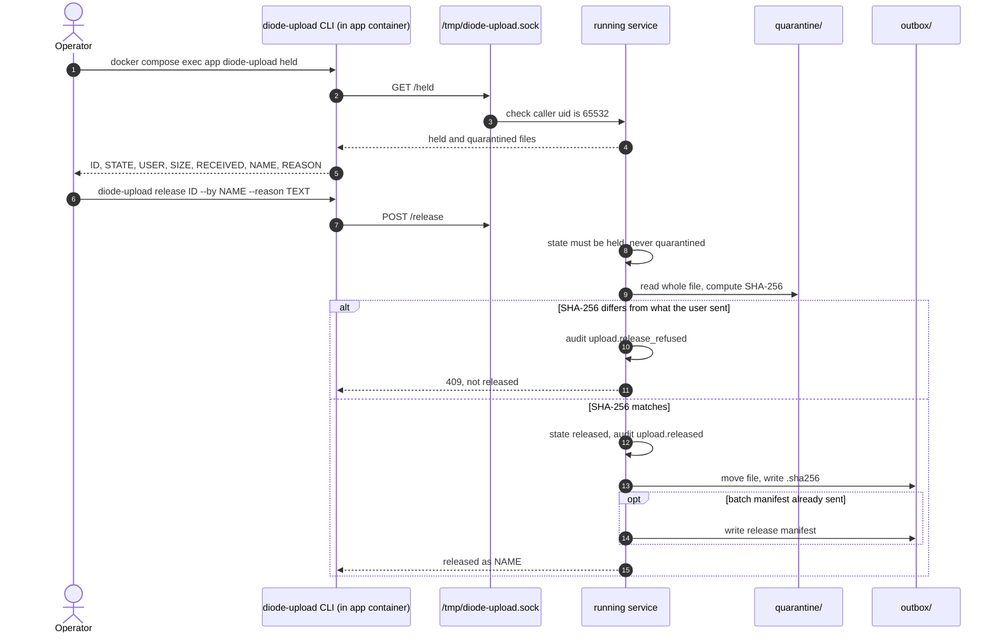
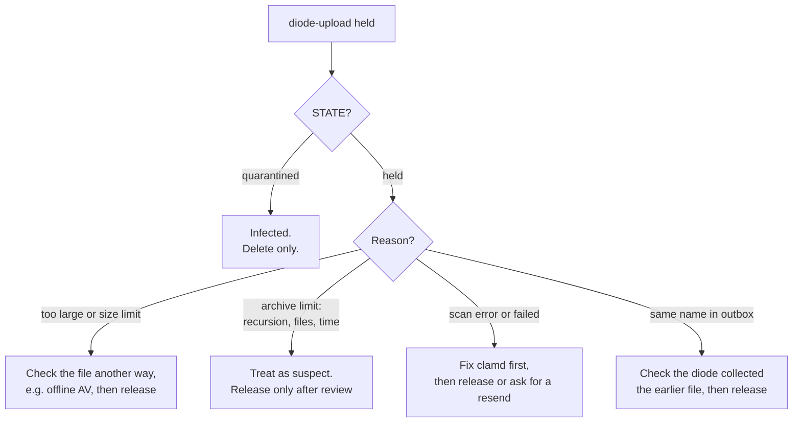

# Held files: operator flow

A file is **held** when the service could not get a clear answer about it.
It waits in `quarantine/<ID>` until an operator releases or deletes it. The
sender's page shows "Held for administrator review". There is no admin web
site yet; operators use commands on the upload host. Code:
`cmd/diode-upload/operator.go`, `internal/control/control.go`,
`internal/pipeline/release.go`.

## Why a file is held

| Reason text starts with | Cause |
| --- | --- |
| `file is N bytes, larger than the scanner limit` | Over 2047 MiB with `OVERSIZE_POLICY=hold` (the default). |
| `scanner size limit reached (Heuristics.Limits.Exceeded.MaxFileSize ...)` or `.MaxScanSize` | clamd hit a size limit, often inside an archive. |
| `scanner limit reached (Heuristics.Limits.Exceeded.MaxRecursion ...)`, `MaxFiles`, `MaxScanTime` | Archive too deep, too many files, or scan over 1 hour. Looks like an archive bomb. |
| `scan error: ...`, `scan failed: ...`, `unrecognized scan result` | clamd returned an error, timed out or answered something unexpected. |
| `staged file missing`, `staged file is N bytes, expected M` | The file in `incoming/` was gone or the wrong size before the scan. |
| `a file with the same name stayed in the outbox for over 1h0m0s` | The diode did not collect an earlier file with the same name. |

**Quarantined** (infected) files are listed by the same command but can
**never** be released. They can only be deleted.

## Diagram



## Steps

### 1. List

```sh
docker compose exec app diode-upload held
```

Lists every upload in state `held` or `quarantined`, oldest first:
`ID`, `STATE`, `USER`, `SIZE` (bytes), `RECEIVED` (UTC), `NAME` (the outbox
name it would get) and `REASON`. For infected files the signature is shown
after the reason in brackets. "No held or quarantined files." when empty.

### 2a. Release

```sh
docker compose exec app diode-upload release <ID> --by "A. Admin" --reason "vendor image, checked with offline AV"
```

- `--by` and `--reason` are required. Each must be plain text, at most 500
  bytes, no control characters. The ID can come before or after the flags.
- Only state `held` can be released. `quarantined` answers
  "infected files cannot be released". Anything else answers
  "only held files can be released; this one is ...".
- The service reads the whole file again and computes its SHA-256. A large
  file takes minutes; the command prints a note and waits (client timeout
  2 hours).
- If the hash differs from the one computed during upload: refused, audit
  `upload.release_refused` with the expected and actual hash. The file stays
  held.
- If it matches: state becomes `released`. The upload record keeps the
  original held reason, who released it, why and when. Audit
  `upload.released`.
- The file then goes through the normal [outbox handoff](Outbox-Handoff-and-Batches):
  same name it would have had, mode 0644, `.sha256` sidecar, same-name
  waiting. A released file whose name stays taken for an hour is held again.
- If the batch manifest has already been written, a release manifest
  `<batch>.release-<ID first 8>.manifest.json` follows. If the batch is
  still open, the file appears in the batch manifest as `released`.
- The sender's page shows the file as "Sent to the diode" if it is still
  open.

### 2b. Delete

```sh
docker compose exec app diode-upload delete <ID> --by "A. Admin" --reason "sender asked to drop it"
```

- Works for `held` and `quarantined` files.
- Removes `quarantine/<ID>`. State becomes `deleted`; the reason keeps the
  old state and reason, who deleted it and why. Audit `upload.discarded`
  with `previous_state`.

### Decision guide



The service does not rescan a held file. There is no rescan command yet.

## The control socket

- The commands talk to the running service over a unix socket inside the
  app container: `/tmp/diode-upload.sock` (`CONTROL_SOCKET`; `off` disables
  it). It lives on the container's tmpfs.
- The socket is mode 0600. The service checks the caller's user ID with
  `SO_PEERCRED` and drops any connection that is not its own uid (65532).
  The log says `control socket: connection from another user refused`.
- So the only way in is `docker compose exec app ...`, which needs Docker
  access on the host. Nothing is exposed on the network.
- The socket speaks HTTP/JSON: `GET /held`, `POST /release`, `POST /delete`
  with `{"id", "by", "reason"}`. Errors come back as `409` (refused) or
  `404` (unknown ID).

## Every action is audited

| Action | Audit event | Actor |
| --- | --- | --- |
| Release | `upload.released` | `admin` / the `--by` name |
| Release refused (hash changed) | `upload.release_refused` | `admin` / the `--by` name |
| Delete | `upload.discarded` | `admin` / the `--by` name |

Listing is not audited.
