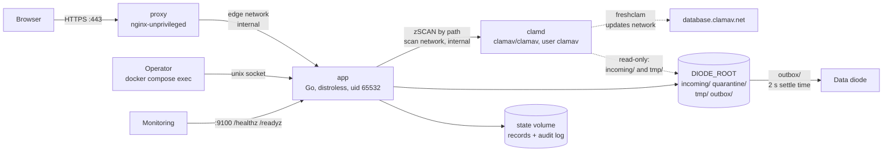
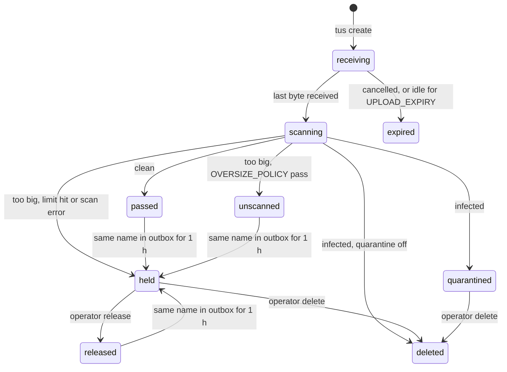

# docker-secure-upload

This wiki explains how the diode upload service works, step by step. It is
written for the people who run the upload host and the data diode.

The service takes files from users in a browser, checks them for viruses,
fingerprints them with SHA-256 and puts them in the folder the diode
watches. It runs as one Docker Compose stack on one Linux host.

These pages describe release **v0.5.3-beta**. The code is the source of
truth; the README in the repository has the same facts in shorter form.

## The parts

| Container | Image | Runs as | Can see |
| --- | --- | --- | --- |
| `proxy` | `nginxinc/nginx-unprivileged:stable-alpine` | nginx user | TLS files, nginx.conf |
| `app` | built from `Dockerfile` (distroless static) | uid 65532 | all of `DIODE_ROOT` at `/data`, `state` volume at `/state` |
| `clamd` | `clamav/clamav:stable` via `/init-unprivileged` | `clamav`, plus group 65532 | `incoming/` and `tmp/` only, read-only; `clamdb` volume |

All three have a read-only root filesystem, `cap_drop: ALL`,
`no-new-privileges`, memory, CPU and process limits, and rotated logs.

## Folders

| Folder (under `DIODE_ROOT`) | What is in it | Who reads it |
| --- | --- | --- |
| `incoming/` | Files being received and waiting for a scan, named by a random 32-hex ID | app, clamd (read-only) |
| `tmp/` | Scratch files: the EICAR self-test file, sidecars and manifests before they are moved. Emptied at startup | app, clamd (read-only) |
| `quarantine/` | Held and infected files, named by upload ID | app only |
| `outbox/` | Files for the diode, their `.sha256` sidecars and the batch manifests | app writes, diode reads and removes |

The service state (one JSON record per batch and per upload, and the audit
log) is in the Docker volume `diode-upload_state`, mounted at `/state`.

## A file's states

| State | File is in | Page shows |
| --- | --- | --- |
| `receiving` | `incoming/` | Uploading |
| `scanning` | `incoming/` | Scanning for viruses |
| `passed` | `outbox/` | Sent to the diode |
| `unscanned` | `outbox/` | Sent; too large to scan fully |
| `released` | `outbox/` | Sent to the diode |
| `held` | `quarantine/` | Held for administrator review |
| `quarantined` | `quarantine/` | Blocked by antivirus |
| `deleted` | removed | Blocked by antivirus |
| `expired` | removed | Cancelled |

## Pages

Flows:

1. [Upload flow](Upload-Flow): page load, batch, tus create, chunks, resume, completion.
2. [Scan and classification](Scan-and-Classification): queue, EICAR gate, clamd, result table.
3. [Outbox handoff and batch lifecycle](Outbox-Handoff-and-Batches): atomic placement, same-name wait, sidecar, manifests, batch open and close.
4. [Held files: operator flow](Held-Files): list, release, delete, control socket.
5. [Request security](Request-Security): proxy, Origin, Sec-Fetch-Site, CSRF, limits, 403 and 429.
6. [Startup, health and signatures](Startup-Health-and-Signatures): storage checks, self-test, `/healthz`, `/readyz`, freshclam, planned offline bundle.

Operations:

7. [Deployment and upgrade](Deployment-and-Upgrade): host layout, `.env`, upgrades, smoke test.
8. [Troubleshooting](Troubleshooting): symptoms, log lines and fixes.

## Audit events

Every step is written to a hash-chained log in `/state/audit/audit-YYYY-MM-DD.jsonl`.
Each event holds `seq`, `ts`, `actor_type` (`user`, `admin`, `system`),
`actor`, `action`, IDs, `details`, `prev_hash` and `hash`. Check the chain
with `docker compose exec app diode-upload verify-audit`.

| Action | Actor | When |
| --- | --- | --- |
| `service.started` | system / service | The app started (details: version, oversize policy, quarantine on or off) |
| `batch.created` | user | `POST /api/v1/batches` succeeded |
| `upload.created` | user | tus create succeeded |
| `upload.received` | user | Last byte arrived; carries the SHA-256 |
| `upload.cancelled` | user | The page sent tus `DELETE` |
| `upload.expired` | system / janitor | No data for `UPLOAD_EXPIRY` |
| `upload.passed`, `upload.unscanned`, `upload.held`, `upload.quarantined`, `upload.deleted` | system / scanner | Scan decision recorded |
| `upload.held` | system / outbox | Same-name file stayed in the outbox for over an hour |
| `upload.released` | admin | Operator released a held file |
| `upload.release_refused` | admin | Release refused because the SHA-256 changed |
| `upload.discarded` | admin | Operator deleted a held or quarantined file |
| `batch.closed` | system / outbox | Manifest written |
| `batch.discarded` | system / janitor | A batch that never got a file was dropped |

## Not built yet

- No sign-in. Anyone who can reach port 443 can upload. Limit it with the host firewall.
- No admin web site. Held files are handled with commands; see [Held files](Held-Files).
- No retention pruning for the audit log or quarantine.
- No `/metrics` endpoint.
- No offline signature bundle; see [Startup, health and signatures](Startup-Health-and-Signatures#planned-offline-signature-bundle).
