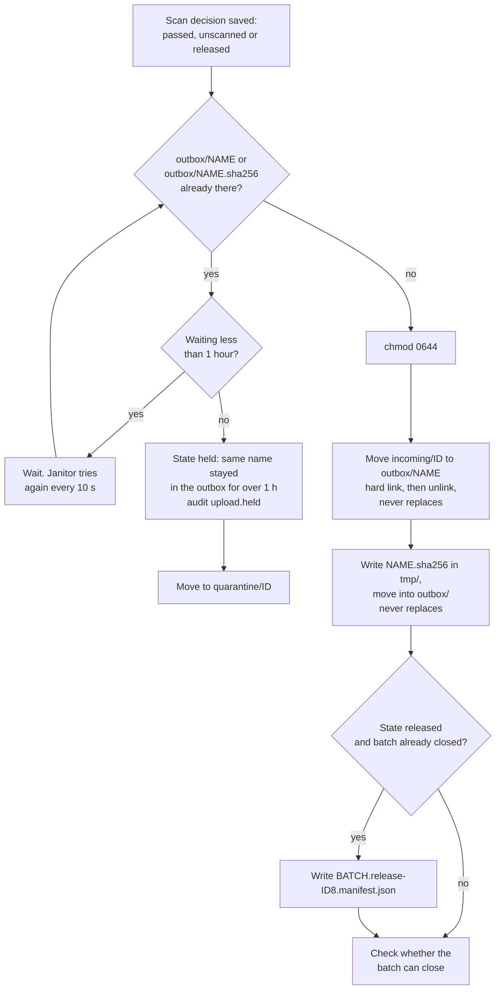
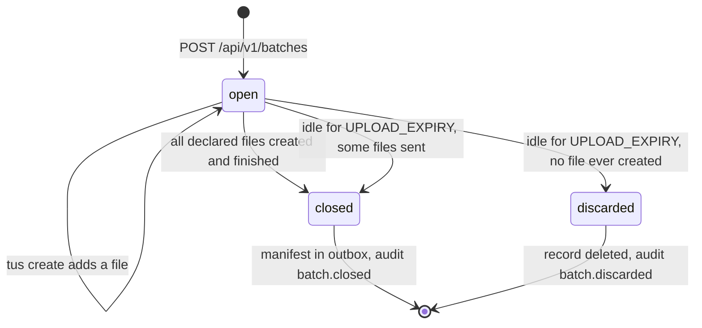

# Outbox handoff and batch lifecycle

How a passed file reaches `outbox/`, what the diode finds there, and when a
batch gets its manifest. Code: `internal/pipeline/pipeline.go`,
`internal/fsutil/fsutil.go`, `internal/names/names.go`.

## What the diode sees

```
outbox/
  Quarterly Report (final).pdf
  Quarterly Report (final).pdf.sha256
  20261103T141502Z-jsmith-a3f9c1.manifest.json
  20261103T141502Z-jsmith-a3f9c1.release-3f1c9a2b.manifest.json   (only after a late release)
```

For each batch the order is always:

1. each file, as soon as it passes (one atomic move);
2. its `.sha256` sidecar, right after the file;
3. the batch manifest, last, once every file in the batch has an end state.

The diode watches with a 2-second settle time. No file in `outbox/` is ever
written in place: everything is complete before it appears under its final
name.

## Handoff diagram



## Steps

### Atomic placement

- `incoming/`, `quarantine/`, `tmp/` and `outbox/` are on one filesystem.
  The service refuses to start otherwise, so every move is a rename on one
  disk, never a copy.
- The file's mode is set to 0644 first, so the diode can read it.
- The move is a hard link to the outbox name followed by removing the staged
  name. A hard link fails if the name already exists, so nothing is ever
  overwritten. On filesystems without hard links it falls back to a rename
  after checking the name is free. Both folders are fsynced.
- Each step is recorded (`placed`, `sidecar_done`, `manifest_done` in the
  upload record), so a crash at any point is finished by the janitor without
  repeating or skipping a step.

### Same-name waiting

Files keep the sender's name by default, so two uploads can want the same
outbox name.

- If `outbox/<name>` or `outbox/<name>.sha256` belongs to another file that
  is still there, the new file waits. The log says once:
  `waiting for the diode to collect a file with the same name`.
- The janitor tries again every 10 seconds. With a 2-second settle time the
  wait is normally short.
- If the name is still taken 1 hour after the scan (or after the release),
  the file becomes `held` with reason "a file with the same name stayed in
  the outbox for over 1h0m0s". Audit `upload.held` from `system / outbox`.
  It moves to `quarantine/` and an operator can release it later.
- The service never decides what the receiving side does with two files of
  the same name.

### Sidecar

- `<name>.sha256` contains one line: `<64 hex>  <name>` (two spaces), the
  format `sha256sum -c` reads.
- It is written to `tmp/`, then moved into `outbox/` without replacing
  anything. If a sidecar with the exact same content is already there (an
  earlier attempt), that counts as done. If a different one is there, the
  file waits as above.

### File names

Set when the upload is created.

- By default: the sender's file name, made safe. Directory parts dropped;
  control characters and `< > : " / \ | ? *` become `_`; invisible and
  direction-changing Unicode characters become `_`; leading dots and spaces
  and trailing dots and spaces are removed; Windows device names (`CON`,
  `NUL`, `COM1` ...) get a leading `_`; names over 180 bytes are shortened,
  keeping the extension; names ending in `.sha256` or `.manifest.json` get a
  trailing `_`. An empty result becomes `file`.
- With **Add the batch ID and my username to file names**:
  `<batch ID>_<3-digit sequence>_<safe name>`.
- Spaces, accents, other scripts and punctuation are kept. Receiving-side
  scripts must quote file names.

### Batch manifest

`<batch ID>.manifest.json`, mode 0644, written to `tmp/` and renamed into
`outbox/`. Example:

```json
{
  "schema": 1,
  "batch_id": "20261103T141502Z-jsmith-a3f9c1",
  "username": "jsmith",
  "created_at": "2026-11-03T14:15:02Z",
  "closed_at": "2026-11-03T14:17:40Z",
  "file_count_declared": 3,
  "files": [
    {
      "name": "Quarterly Report (final).pdf",
      "original_name": "Quarterly Report (final).pdf",
      "size": 1048576,
      "sha256": "<64 hex>",
      "scan_status": "clean",
      "clamav_db": "ClamAV 1.4.1/27800",
      "scanned_at": "2026-11-03T14:17:38Z"
    }
  ],
  "withheld_count": 1,
  "missing_count": 1,
  "audit_head": { "seq": 1234, "hash": "<64 hex>" },
  "generator": "docker-secure-upload v0.5.3-beta"
}
```

| Field | Meaning |
| --- | --- |
| `file_count_declared` | Files the page said it would send. |
| `files[]` | Only files that are in the outbox: states `passed`, `unscanned`, `released`. |
| `scan_status` | `clean`, `unscanned` (with `scan_reason`) or `released` (with `scan_reason` saying why it was held and who released it). |
| `withheld_count` | Files that ended in any other state: `held`, `quarantined`, `deleted`, `expired` (including cancelled). Only counted; their names never cross the diode. |
| `missing_count` | Files declared but never created (for example the page was closed). |
| `audit_head` | `seq` and `hash` of the newest audit event when the manifest was written. Keep manifests on the receiving side: a later rewrite of the upload host's audit log no longer matches them. |
| `generator` | Service name and version. |

Audit `batch.closed` with the manifest name and the passed, withheld and
missing counts.

### Release manifests

A held file released after its batch manifest has gone gets its own
manifest: `<batch ID>.release-<first 8 characters of the upload ID>.manifest.json`.
It has the same layout with one file, `file_count_declared: 1`, and a
`release` block: `upload_id`, `held_reason`, `released_by`, `reason`,
`released_at`. It is written after the file and its sidecar.

If the batch is still open when the file is released, no extra manifest is
written: the file is listed in the batch manifest with `scan_status: released`.

### File modes

| Where | Files | Folders |
| --- | --- | --- |
| `outbox/` (files, sidecars, manifests) | 0644 | 2775, group of the diode (set by you) |
| `incoming/`, `quarantine/`, `tmp/` | 0640 | 0750, owner 65532 |
| `/state` (records, audit) | 0640 | 0750 |

clamd reads staging files through group 65532. Nothing else on the host can
read them. The diode needs write access to `outbox/` to remove what it has
collected.

## Batch lifecycle



- **Open.** The batch has a declared file count and a counter of files
  created so far. It counts against the open-batch limit until it closes.
  A tus create for a closed batch, or for a batch that already has all its
  declared files, gets `409`.
- **Check.** After every file is placed, and every 10 seconds by the
  janitor, the service checks whether the batch can close.
- **Closed (normal).** Every declared file has been created, and every one
  has an end state and has been placed (and its sidecar written, if it went
  to the outbox). Held files do not block closing: they are counted in
  `withheld_count`.
- **Closed (idle).** Nothing happened in the batch for `UPLOAD_EXPIRY`
  (1 hour), counted from the newest change to any of its files, or from
  creation. The manifest is written with `missing_count` set, as long as
  the files that do exist are finished. Files still `receiving` are expired
  by the janitor first.
- **Discarded.** Idle for `UPLOAD_EXPIRY` and no file was ever created. The
  record is deleted rather than sending the diode an empty manifest.

A slow batch is never closed while it is still sending: every chunk counts
as activity.
