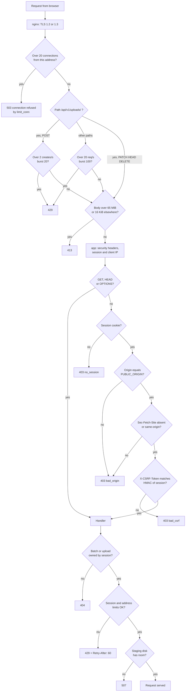

# Request security

The checks every request passes, from the proxy to the handler, and which
status code each failure gives. Code: `deploy/nginx/nginx.conf`,
`internal/web/web.go`, `internal/limits/limits.go`, `internal/tus/tus.go`.

## Diagram

The limit and disk checks apply only to creating a batch (limits) and
creating an upload (limits and disk).

## Steps

### 1. Proxy (nginx)

- TLS 1.2 and 1.3 only, certificate from `deploy/tls/upload.crt` and
  `upload.key`. Published on `HTTPS_BIND:443`.
- At most 20 open connections per client address.
- Upload creation (`POST` to `/api/v1/uploads/`): 2 per second per address,
  burst 20. Chunks (`PATCH`) are not counted. Over the limit: `429`.
- Every other path: 20 requests per second per address, burst 100. Over:
  `429`.
- Body size: 65 MiB on `/api/v1/uploads/` (one 64 MiB chunk plus 1 MiB),
  16 KiB everywhere else. Over: `413`.
- Chunks are streamed to the app, never spooled to the proxy's disk. At most
  60 seconds may pass between two reads of a body.
- nginx sets `X-Real-IP` to the client address and clears `X-Forwarded-For`.

### 2. App: headers and identity

- Every response gets a strict Content-Security-Policy (only `'self'`,
  Trusted Types required), HSTS, `X-Frame-Options: DENY`,
  `X-Content-Type-Options: nosniff`, `Referrer-Policy: no-referrer`,
  cross-origin isolation headers and a Permissions-Policy. API responses
  are `Cache-Control: no-store`.
- The client address is taken from `X-Real-IP` only when the direct peer is
  in `TRUSTED_PROXY_CIDRS` (the `edge` network, `172.30.10.0/24`).
  Otherwise the peer address is used.
- The session comes from the `__Host-sid` cookie. Other packages only ever
  see a SHA-256 of the session ID.

### 3. App: write checks (CSRF)

For every method except `GET`, `HEAD` and `OPTIONS`, including tus `PATCH`
and `DELETE`:

| Check | Fails with | Page shows |
| --- | --- | --- |
| A session cookie is present | `403` `no_session` | reload the page and try again |
| `Origin` is exactly `PUBLIC_ORIGIN` (scheme, host and port) | `403` `bad_origin` | request did not come from this site |
| `Sec-Fetch-Site`, if sent, is `same-origin` | `403` `bad_origin` | request did not come from this site |
| `X-CSRF-Token` equals HMAC-SHA256(`csrf_key`, session ID) | `403` `bad_csrf` | reload the page and try again |

Every refusal logs `request rejected` with `reason`, `method`, `path`,
`client_ip`, the `origin` sent, `expected_origin`, `sec_fetch_site` and
whether a token was present. Header values are cut to 200 characters.

There is no CORS: no `Access-Control-*` header is ever sent.

### 4. App: request shape

- JSON API: `Content-Type: application/json`, at most 16 KiB, unknown
  fields refused (`400`).
- tus: `Tus-Resumable: 1.0.0` required (`412` otherwise). Only `batch_id`
  and `filename` metadata. Upload IDs must be 32 hex characters.
- File names from the client are never used as paths. Files are stored by
  random ID; outbox names go through the name cleaner.

### 5. App: ownership

A batch or upload that belongs to another session gets `404`, exactly like
one that does not exist.

### 6. App: limits

Checked when a batch or an upload is created. The check and the creation
happen under one lock, so two requests cannot both slip under a cap.

| | Per session | Per address |
| --- | --- | --- |
| Open batches (no manifest yet) | `SESSION_MAX_OPEN_BATCHES` = 10 | `IP_MAX_OPEN_BATCHES` = 30 |
| Uploads still receiving | `SESSION_MAX_OPEN_UPLOADS` = 20 | `IP_MAX_OPEN_UPLOADS` = 60 |
| Bytes still to arrive | `SESSION_MAX_RESERVED` = 100 GiB | `IP_MAX_RESERVED` = 300 GiB |

- `0` means no cap. Address defaults are 3 times the session values.
- Over a cap: `429` with `Retry-After: 60` and a message naming the cap.
  The log says `batch refused: limit` or `upload refused: limit`.
- The page waits and tries again on its own ("Waiting for your earlier
  uploads to finish").
- Many users behind one address (terminal server, NAT): raise `IP_MAX_*`.

### 7. App: disk

A new upload is refused with `507` ("not enough staging space; try again
later") unless free space on the staging filesystem is at least: the new
file + the remaining bytes of every unfinished upload + `DISK_RESERVE`
(10 GiB). The log says `upload refused: disk`.

## Status code summary

| Code | Where | Cause |
| --- | --- | --- |
| `400` | app | Bad JSON, username, file count, tus header or metadata |
| `403` | app | `no_session`, `bad_origin`, `bad_csrf` |
| `404` | app | Unknown, or another session's, batch or upload |
| `409` | app | Batch closed or full; wrong `Upload-Offset`; upload already complete |
| `412` | app | Missing or wrong `Tus-Resumable` |
| `413` | nginx or app | Body too large; file over `MAX_FILE_SIZE`; oversize with policy `reject` |
| `415` | app | `PATCH` without `application/offset+octet-stream` |
| `423` | app | Another request is writing to the same upload |
| `429` | nginx or app | Rate limit (nginx) or open-work cap (app) |
| `503` | nginx | Connection limit |
| `507` | app | Staging disk too full |
