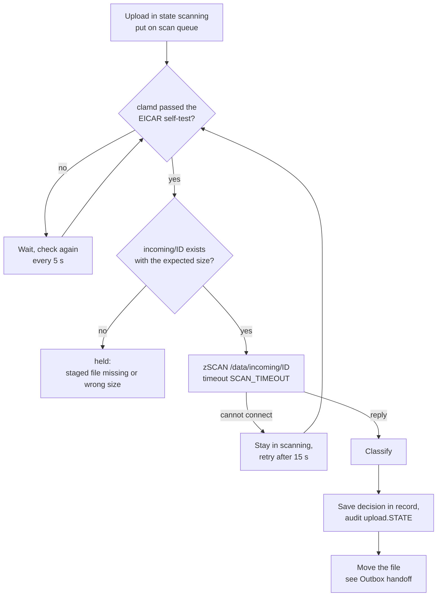
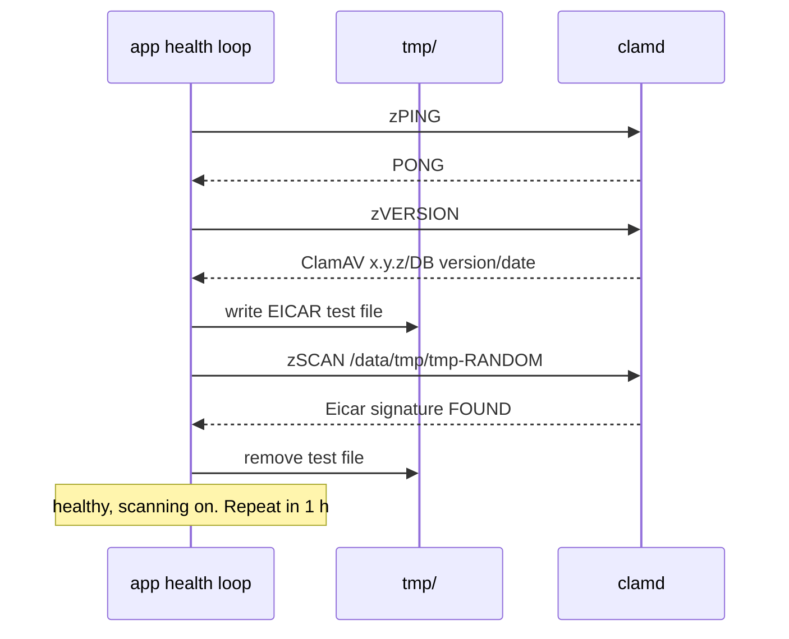

# Scan and classification

What happens between "last byte received" and a file's end state. Code:
`internal/pipeline/pipeline.go`, `internal/pipeline/classify.go`,
`internal/clamd/clamd.go`, `deploy/clamd/clamd.conf`.

## Diagram

## Steps

### 1. Queue

- A completed upload is put on an in-memory queue (room for 10 000).
  The same upload is never queued twice.
- `SCAN_CONCURRENCY` workers (default 2) take uploads from the queue.
- The janitor re-queues every upload still in `scanning` every 10 seconds,
  and once at startup. So a full queue or a restart loses nothing.

### 2. EICAR self-test gate

A worker never scans until clamd has proved it detects the EICAR test file.

- If any step fails, scanning pauses. The log says
  `clamd self-test failed; scanning paused`. The test is tried again after
  5 seconds, then 10, 20, 40, and then every minute.
- On success the log says `clamd self-test passed; scanning enabled` with
  the database version. The test repeats every hour.
- The database version from `VERSION` (for example `ClamAV 1.4.1/27800`)
  is stored with each scan result and written into the manifest as
  `clamav_db`. It is refreshed at each self-test, so it can be up to an hour
  behind a signature reload.
- `/readyz` answers 200 only while the last self-test passed. See
  [Startup, health and signatures](Startup-Health-and-Signatures).

### 3. Pre-checks

Before scanning, the worker checks that `incoming/<ID>` exists and has the
size the user declared. If not, the file is `held` ("staged file missing",
or "staged file is N bytes, expected M").

### 4. Scan

- The app sends `zSCAN <path>` over TCP to `clamd:3310`. clamd opens the
  file itself from its read-only mount, so clamd's stream size limit does
  not apply. The path is `CLAMD_PATH_PREFIX` + `/incoming/<ID>`.
- The scan has a deadline of `SCAN_TIMEOUT` (2 hours).
- If the app cannot connect to clamd, the file stays in `scanning` and is
  tried again after 15 seconds (log: `clamd unreachable; scan postponed`).
  It is not held.
- Any other failure (timeout, dropped connection, reply the client cannot
  parse) is a scan failure, and the file is held.

clamd settings that matter (`deploy/clamd/clamd.conf`):

| Setting | Value | Effect |
| --- | --- | --- |
| `MaxFileSize` | 2047M | Largest single file scanned. libclamav cannot go above 2 GiB. Must equal `CLAMD_MAX_SCAN_SIZE`. |
| `MaxScanSize` | 4000M | Most data extracted from one archive. |
| `AlertExceedsMax` | yes | Hitting a size limit is reported as `Heuristics.Limits.Exceeded.*`, not `OK`. |
| `MaxRecursion` / `MaxFiles` / `MaxScanTime` | 17 / 10000 / 1 h | Archive-bomb limits. |
| `AlertEncrypted` | yes | Encrypted archives and documents are reported as `Heuristics.Encrypted.*`. |

### 5. Classification

The app never treats an unexpected or partial result as clean.

| clamd result | Condition | End state | Reason recorded |
| --- | --- | --- | --- |
| `OK` | size ≤ `CLAMD_MAX_SCAN_SIZE` | **passed** | |
| `OK` | size > `CLAMD_MAX_SCAN_SIZE` | **held** (policy `hold` or `reject`), **unscanned** (policy `pass`) | file is N bytes, larger than the scanner limit |
| `FOUND Heuristics.Limits.Exceeded.MaxFileSize` or `.MaxScanSize` | | **held** (policy `hold` or `reject`), **unscanned** (policy `pass`) | scanner size limit reached |
| `FOUND Heuristics.Limits.Exceeded.` anything else (`MaxRecursion`, `MaxFiles`, `MaxScanTime`) | | **held** | scanner limit reached |
| `FOUND` any other signature, including `Heuristics.Encrypted.*` | `QUARANTINE_ENABLED=true` | **quarantined** | infected: SIGNATURE |
| `FOUND` any other signature | `QUARANTINE_ENABLED=false` | **deleted** | infected: SIGNATURE |
| `ERROR` | | **held** | scan error: MESSAGE |
| timeout, connection lost, unparseable reply | | **held** | scan failed: ... |
| anything else | | **held** | unrecognized scan result |

With `OVERSIZE_POLICY=reject`, files over the limit are refused at tus
create (`413`). A file that still reaches classification as oversize (for
example an archive that expands past `MaxScanSize`) is held, not passed.

### 6. Record, then move

1. The decision is saved in the upload record first: state, reason, raw
   verdict, signature, database version, scan time.
2. The audit log gets `upload.<state>` from `system / scanner`, with state,
   SHA-256, size and reason.
3. The file is moved. If the process dies between steps 1 and 3, the
   janitor finishes the move from the record.

| End state | File goes to | Next |
| --- | --- | --- |
| `passed` | `outbox/<name>` | [Outbox handoff](Outbox-Handoff-and-Batches) |
| `unscanned` | `outbox/<name>`, flagged in the manifest | [Outbox handoff](Outbox-Handoff-and-Batches) |
| `held` | `quarantine/<ID>` | [Held files](Held-Files) |
| `quarantined` | `quarantine/<ID>` | Can only be deleted |
| `deleted` | removed | Nothing |

Two more states are set elsewhere: `expired` (cancelled or abandoned, see
[Upload flow](Upload-Flow)) and `released` (see [Held files](Held-Files)).
