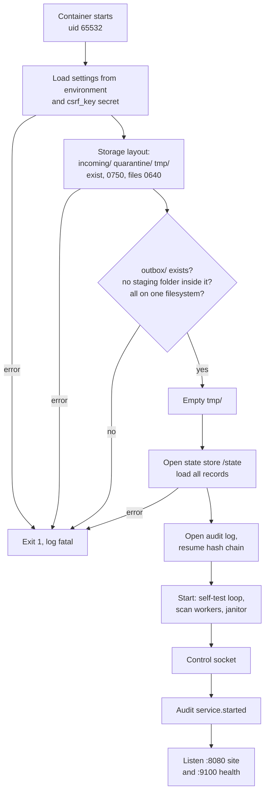
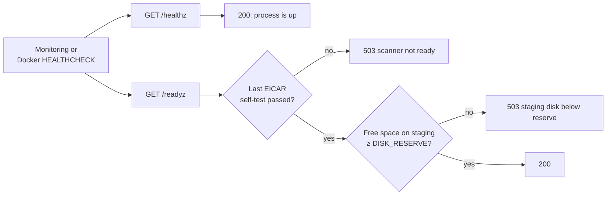
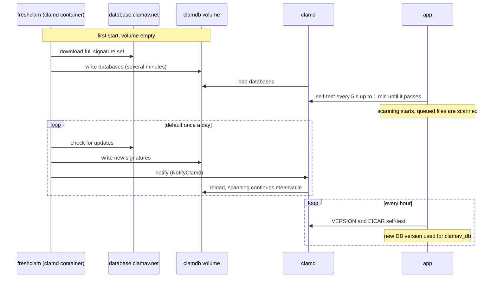
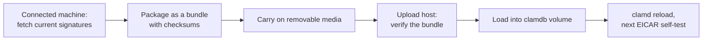

# Startup, health and signatures

What the app checks when it starts, what the health endpoints mean, and how
clamd gets its virus signatures. Code: `cmd/diode-upload/main.go`,
`internal/pipeline/pipeline.go`, `internal/config/config.go`, `Dockerfile`,
`deploy/clamd/`.

## Startup

### Steps

1. **Settings.** `PUBLIC_ORIGIN` must be an origin (`https://host[:port]`,
   no path). The CSRF key file must hold at least 32 bytes. Sizes,
   durations and policies are validated. All errors are reported together
   and the app exits.
2. **Storage layout** (log prefix `storage layout:`).
   - Creates `incoming/`, `quarantine/` and `tmp/` if missing, sets them to
     0750, and sets files inside to 0640 (tightens folders from older
     versions). If it cannot change a folder's mode, the error ends with
     "(the folder must belong to uid 65532)".
   - `outbox/` must already exist (`outbox: ... no such file or directory`).
   - No staging folder may be inside the outbox.
   - All four folders must be on one filesystem, or atomic moves are
     impossible and the app refuses to start.
   - `tmp/` is emptied.
3. **State store** (`state store:`). Creates `/state/batches`,
   `/state/uploads` and `/state/tmp`, empties `/state/tmp`, and loads every
   record into memory.
4. **Audit log** (`audit log:`). Opens `/state/audit` and continues the
   hash chain from the last event.
5. **Pipeline.** Starts the self-test loop, the scan workers and the
   janitor. The janitor runs at once: it re-queues files that were
   `scanning`, finishes interrupted moves, expires idle uploads and closes
   ready batches. Uploads that were `receiving` keep their offset and hash
   state; the page can resume them.
6. **Control socket** at `/tmp/diode-upload.sock`, unless `CONTROL_SOCKET=off`.
7. **Audit** `service.started` with version, oversize policy and whether
   quarantine is on.
8. **Listen.** The site on `:8080` (only the proxy reaches it) and health on
   `HEALTH_ADDR` (`0.0.0.0:9100`, published on `MONITORING_BIND`,
   `127.0.0.1` by default). Log line `listening`.

The site accepts uploads before clamd is ready. Files wait in `scanning`
until the self-test passes.

**Shutdown.** On `SIGTERM` the servers get 30 seconds to finish. A scan cut
short is not decided; the file is still `scanning` and is scanned again at
the next start.

## Health endpoints

| Endpoint | 200 means | 503 means |
| --- | --- | --- |
| `/healthz` | The process answers. | (never) |
| `/readyz` | clamd passed its latest EICAR self-test, and the staging filesystem has at least `DISK_RESERVE` free. | `scanner not ready` or `staging disk below reserve` |

- The image's Docker `HEALTHCHECK` runs `diode-upload healthcheck`, which
  calls `/readyz` on `127.0.0.1:9100`. Every 30 s, 5 s timeout, 3 retries,
  10-minute start period (time for clamd's first signature download).
- `docker compose ps` therefore shows the app as unhealthy while clamd is
  not working or the disk is low, even though the site still answers.
- Check by hand: `curl -s http://127.0.0.1:9100/readyz`.
- `/metrics` is not built yet.

## Signature updates

clamd runs from the `clamav/clamav:stable` image through its
`/init-unprivileged` entrypoint, as user `clamav`. That entrypoint starts
both freshclam (the updater, as a daemon) and clamd.

### Steps

- Settings are in `deploy/clamd/freshclam.conf`: mirror
  `database.clamav.net`, `ScriptedUpdates yes`, `NotifyClamd` so clamd
  reloads after an update, log to the container output.
- How often freshclam checks is set by the image (`FRESHCLAM_CHECKS`,
  once a day by default). The compose file does not change it.
- clamd has `ConcurrentDatabaseReload yes`, so scans continue during a
  reload, and `SelfCheck 600`, so it also checks its database every
  10 minutes.
- Signatures are kept in the `clamdb` volume (`diode-upload_clamdb`), so a
  restart does not download them again.
- clamd reaches the internet through the `updates` network, the only
  non-internal network it has. If signatures come from an internal mirror on
  the `scan` network, point `freshclam.conf` at the mirror and remove
  `updates` from the clamd service.
- The app learns the database version from clamd's `VERSION` reply at each
  hourly self-test. That value goes into each scan record and the manifest
  `clamav_db` field.
- If an update breaks clamd, the next self-test fails, scanning pauses,
  `/readyz` returns 503 and files wait in `scanning`. Nothing is passed
  unscanned.
- Check freshclam: `docker compose logs clamd | grep -i freshclam` and
  `docker compose exec clamd pgrep -x freshclam`.

### Planned: offline signature bundle

> **Planned, not built.** v0.5.3-beta has no offline or sneakernet update
> path. The only way to update signatures today is freshclam over the
> network (direct or through an internal mirror).

For hosts with no route to a mirror, an offline bundle is planned. The
outline below shows the intent only; formats, checks and commands are not
decided and nothing in the repository implements them yet.

