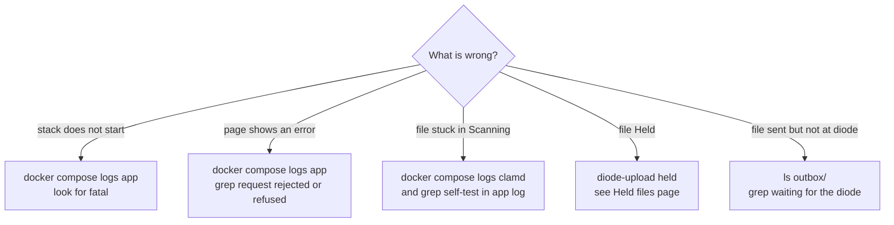

# Troubleshooting

Symptoms, the log lines that go with them, and fixes. The first table is
the README's; the rest comes from the code's log messages.

Useful commands:

```sh
docker compose ps                                      # health of each container
docker compose logs -f app                             # JSON log lines from the app
docker compose logs -f clamd                           # clamd and freshclam
curl -s http://127.0.0.1:9100/readyz                   # 200, or why not
docker compose exec app diode-upload held              # held and quarantined files
docker compose exec app diode-upload verify-audit      # audit chain check
```

## Where to look



## From the README

| Symptom | Cause and fix |
| --- | --- |
| `no configuration file provided: not found` | The Docker snap is in use (`which docker` prints `/snap/bin/docker`). Install Docker Engine from Docker's apt repository. See [Deployment and upgrade](Deployment-and-Upgrade). |
| `state store: mkdir /state/batches: permission denied` | The `state` volume was created by an image from before v0.5.1, so it is owned by root. If nothing has been uploaded yet: `docker compose down`, then `docker volume rm diode-upload_state`, then `docker compose up -d --build`. To keep existing data instead: `docker run --rm -v diode-upload_state:/state busybox chown -R 65532:65532 /state` |
| Upload page says `Could not start: request did not come from this site` | `PUBLIC_ORIGIN` does not exactly match the address in the browser (scheme, host name and port all count). `docker compose logs app \| grep "request rejected"` shows the `origin` the browser sent next to `expected_origin`. In the browser's developer console, `location.origin` prints the value to use. Set `PUBLIC_ORIGIN` to it in `.env` (no trailing slash), run `docker compose up -d app`, then reload the page. Users must all use that one address. |
| Upload page says `reload the page and try again` | The page's session cookie or CSRF token is missing or no longer valid, for example because `secrets/csrf_key` was changed while the page was open, or the browser blocked the cookie. Reload the page. The log line `request rejected` shows `reason` `no_session` or `bad_csrf`. |
| `storage layout: ... permission denied` or `outbox: ... no such file or directory` | `DIODE_ROOT` or its `outbox/` is missing or not writable by uid 65532. See [Deployment and upgrade](Deployment-and-Upgrade#host-layout). |
| `storage layout: ... (the folder must belong to uid 65532)` | `incoming/`, `quarantine/` or `tmp/` under `DIODE_ROOT` was created by Docker or by root. `sudo chown 65532:65532 "$DIODE_ROOT"/{incoming,quarantine,tmp}`, then `docker compose up -d`. |
| A file shows "Waiting for your earlier uploads to finish" | A limit is reached for that browser or computer. It starts by itself when earlier uploads finish. `docker compose logs app \| grep "refused: limit"` shows which cap. See [Request security](Request-Security#6-app-limits). |
| A file shows "Held for administrator review" | See [Held files](Held-Files). |
| Uploads stay at "Scanning" for a long time after the first start | clamd is still downloading signatures. `docker compose logs -f clamd`; scanning starts after the app logs `clamd self-test passed`. |

## More, from the code

| Symptom or log line | Cause and fix |
| --- | --- |
| App exits: `... are on different filesystems; atomic renames between them are impossible` | `outbox/` and the staging folders are on different filesystems. Put them on one filesystem under `DIODE_ROOT`. |
| App exits: `... is inside the outbox; the diode would collect staging files` | `OUTBOX_DIR` points at a parent of a staging folder. Use a separate `outbox/`. |
| App exits: `PUBLIC_ORIGIN must be an origin such as https://upload.example` | `PUBLIC_ORIGIN` empty, or has a path or trailing slash. |
| App exits: `CSRF key: ...` or `CSRF key must be at least 32 bytes` | `secrets/csrf_key` missing or too short. Create it as shown in [Deployment and upgrade](Deployment-and-Upgrade#first-install). |
| `clamd self-test failed; scanning paused` | clamd is down, still loading, or did not detect EICAR. Files wait in `scanning`; nothing is passed. Check `docker compose logs clamd`. `/readyz` says `scanner not ready`. |
| `clamd unreachable; scan postponed` | The app cannot connect to `clamd:3310`. The file stays in `scanning` and is retried every 15 s. |
| Many files `held` with `scan error:` or `scan failed:` | clamd answered with an error or timed out (`SCAN_TIMEOUT`, 2 h). Fix clamd, then release the files after review. |
| `/readyz` says `staging disk below reserve` | Free space on `DIODE_ROOT` is under `DISK_RESERVE` (10 GiB). Check the diode is collecting from `outbox/`, delete what you can from `quarantine/` with `diode-upload delete`. |
| Page shows `not enough staging space; try again later` (HTTP 507), log `upload refused: disk` | The new file plus all unfinished uploads plus `DISK_RESERVE` do not fit. Same fix as above. |
| `waiting for the diode to collect a file with the same name` | An earlier file with the same outbox name, or its `.sha256`, is still in `outbox/`. Check the diode is running. After 1 hour the new file is held. |
| A file is in `outbox/` but its manifest is not | The manifest waits until every file in the batch is finished, or until the batch has been idle for `UPLOAD_EXPIRY`. Look for files still `scanning` or waiting for a name. |
| Page shows `Failed: gave up after repeated connection failures` | More than 30 chunk failures in a row. Check the network path and the proxy (`docker compose logs proxy`). The user sends the file again. |
| HTTP 429 from nginx (no `Retry-After` from the app) | Proxy rate limit: over 2 upload creations per second, or 20 requests per second, from one address. |
| `diode-upload held` prints `cannot reach the service's control socket (is the app running?)` | The app is not running, or `CONTROL_SOCKET=off`. Run the command inside the app container with `docker compose exec app`. |
| `refused: the held file's SHA-256 is ... but ... was received; not released` | The file in `quarantine/` changed since upload. Do not release it. Investigate, then delete it. |
| `refused: infected files cannot be released` | The file is `quarantined`. It can only be deleted. |
| Log `control socket: connection from another user refused` | Something not running as uid 65532 tried the socket. Investigate. |
| `audit chain FAILED after N events: ... chain broken at seq N` or `event seq N was modified` | An audit file was edited, reordered or cut. Compare with the `audit_head` values in manifests kept on the receiving side. |
| clamd container unhealthy after upgrading to v0.5.3 | The `clamdb` volume is still owned by root. Run the `chown` step in [Deployment and upgrade](Deployment-and-Upgrade#version-notes). |
