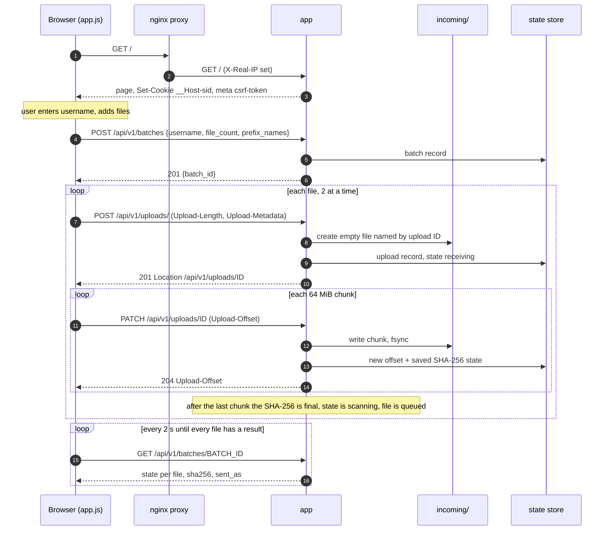
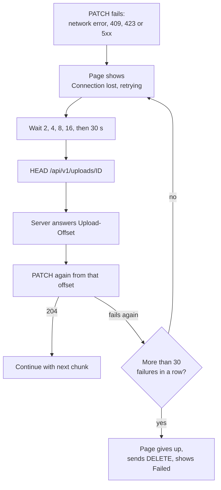

# Upload flow

How a file gets from the browser into `incoming/`. Code: `internal/web/web.go`,
`internal/tus/tus.go`, `internal/web/static/app.js`.

## Diagram

## Steps

### 1. Page load

- The browser asks for `GET /`.
- If it has no valid `__Host-sid` cookie, the app makes one: 32 random bytes as
  hex, `Secure`, `HttpOnly`, `SameSite=Strict`, `Path=/`. A session is only
  ever created on `GET /`.
- The page carries `<meta name="csrf-token">`. The token is
  HMAC-SHA256 of the session ID with the key in `secrets/csrf_key`. The page
  also gets the chunk size, the largest file size and the most files per batch.
- Instructions from `config/instructions.md` are shown on the page.

### 2. The user picks files

- Username: lowercased, must match `^[a-z][a-z0-9._-]{0,31}$`. The page
  remembers it in `localStorage`.
- Dropped folders are skipped ("zip the folder first").
- The page skips files over `MAX_FILE_SIZE`, duplicates (same name, size and
  date) and anything over `MAX_BATCH_FILES` (500).
- The tick box **Add the batch ID and my username to file names** sets
  `prefix_names`.

### 3. Create the batch

`POST /api/v1/batches` with JSON `{"username", "file_count", "prefix_names"}`.

| Result | Meaning |
| --- | --- |
| `201` `{"batch_id": "20261103T141502Z-jsmith-a3f9c1", ...}` | Batch created. Audit `batch.created`. |
| `400 bad_username` / `bad_file_count` | Name invalid, or count not between 1 and `MAX_BATCH_FILES`. |
| `429 limit` with `Retry-After: 60` | Too many open batches for this session or address. See [Request security](Request-Security). |
| `403` | Origin or CSRF check failed. See [Request security](Request-Security). |

The batch ID is `<UTC time>-<username>-<6 hex>`. The page then uploads two
files at a time and polls the batch status every 2 seconds.

### 4. tus create

`POST /api/v1/uploads/` with headers `Tus-Resumable: 1.0.0`,
`Upload-Length: <bytes>` and `Upload-Metadata: batch_id <base64>,filename <base64>`.
No body. Only those two metadata keys are accepted, each up to 1 KiB.

The app checks, in this order:

| Check | Refusal |
| --- | --- |
| `Upload-Length` present and valid, no `Upload-Defer-Length`, no body | `400` |
| Size at most `MAX_FILE_SIZE` (50 GiB) | `413` |
| With `OVERSIZE_POLICY=reject`: size at most `CLAMD_MAX_SCAN_SIZE` | `413` |
| Metadata keys and batch ID valid, file name valid UTF-8, 1 to 1024 bytes, no control characters | `400` |
| Batch exists and belongs to this session | `404 batch not found` |
| Free space covers this file, the rest of every unfinished upload, and `DISK_RESERVE` (10 GiB) | `507` |
| Session and address limits | `429` with `Retry-After: 60` |
| Batch still open and not already holding all its declared files | `409` |

On success:

- A random 32-hex upload ID is made. An empty file `incoming/<ID>` is
  created with mode 0640.
- The outbox name is fixed now (see [Outbox handoff](Outbox-Handoff-and-Batches#file-names)).
- The record is saved with state `receiving`. Audit `upload.created`.
- Reply `201`, `Location: /api/v1/uploads/<ID>`, `Upload-Offset: 0`.
- A zero-byte file skips the chunks: it goes straight to `scanning`.

### 5. Chunks

`PATCH /api/v1/uploads/<ID>` with `Content-Type: application/offset+octet-stream`
and `Upload-Offset`. The page sends 64 MiB (`CHUNK_SIZE`) at a time.

- Only one request may write to an upload at a time. A second gets `423 Locked`.
- `Upload-Offset` must equal the server's offset, or the reply is `409`
  with the server's offset.
- A chunk larger than `CHUNK_SIZE` or the rest of the file gets `413`.
- The app writes the bytes to the file, then feeds the same bytes to the
  SHA-256 hasher, then fsyncs the file.
- It saves the new offset and the hasher's internal state in the upload
  record. This is why a resume, or even a service restart, never re-reads
  data already on disk.
- If the connection drops mid-chunk, the bytes that did arrive are kept.
- Reply `204` with the new `Upload-Offset`.

nginx passes chunks straight through (no buffering to disk). It allows up
to 65 MiB on this path and waits up to 60 seconds between reads.

### 6. Resume after a dropped connection

- Any other `4xx` on a chunk is final: the page sends `DELETE` so the batch
  can close, and shows "Failed".
- If the tus create gets `429`, the page shows "Waiting for your earlier
  uploads to finish" and tries again after `Retry-After` (between 5 and
  120 seconds), up to 30 times.
- The page must stay open. Resuming works within one page; a reloaded page
  has no list of the old uploads.

### 7. Cancel

The **Cancel** button sends `DELETE /api/v1/uploads/<ID>`. This only works
while the upload is `receiving` (otherwise `409`). The state becomes
`expired` with reason "cancelled by user", the staged file is removed, and
the audit log gets `upload.cancelled`.

### 8. Completion

When the last byte arrives:

- The final SHA-256 is stored and the saved hasher state is dropped.
- State becomes `scanning`. Audit `upload.received` with the SHA-256.
- The upload is put on the scan queue. Next: [Scan and classification](Scan-and-Classification).

The page keeps polling `GET /api/v1/batches/<BATCH_ID>`. Each file has a
public state (`uploading`, `scanning`, `sent`, `sent_unscanned`, `blocked`,
`held`, `cancelled`), its SHA-256 and, if the name had to change, `sent_as`
("Arrives as: ..."). Signature names and internal reasons are never shown
to users.

### Abandoned uploads

The janitor runs every 10 seconds. An upload still `receiving` with no
activity for `UPLOAD_EXPIRY` (1 hour) becomes `expired` with reason
"upload not completed in time". Its file is removed. Audit `upload.expired`.

### Isolation

Batches and uploads belong to the session that created them. Any request for
another session's batch or upload gets `404`, the same answer as for one
that does not exist.
